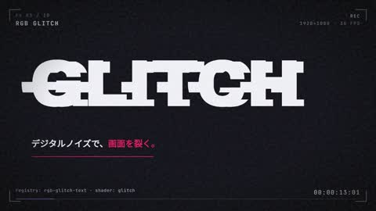

[← 返回图库](../browse/motion.md) · [English](2103738032847552662.en.md)

# 玻璃、金属与传送门的特效作品集

**[Maki@Sunwood AI Labs. · @hAru\_mAki\_ch](https://x.com/hAru_mAki_ch)** · 短动效 · 65s

> 发现池 · 来源已核对，编目资料待完善。

**[▶ 打开画廊播放](https://guanmo-ai.github.io/awesome-ai-motion/#case-2103738032847552662)** · [作者原帖](https://x.com/hAru_mAki_ch/status/2103738032847552662)

点击封面打开画廊播放。

玻璃、金属质感与传送门图形串联成 HyperFrames 与 Paper Shaders 特效作品集。

未取得作者公开提示词。 [查看作者原帖](https://x.com/hAru_mAki_ch/status/2103738032847552662)

收藏 — · 点赞 — · 浏览 —

## 来源记录

- 作品原帖: [@hAru\_mAki\_ch](https://x.com/hAru_mAki_ch/status/2103738032847552662) · 2026-09-26T06:46:47+00:00
- 模型归因: Claude Opus 5.5 · [作者说明](https://x.com/hAru_mAki_ch/status/2103738032847552662)
- 提示词查阅记录: [作者原帖](https://x.com/hAru_mAki_ch/status/2103738032847552662) · 2026-11-02 09:52 UTC
- 封面来源: [原帖封面来源](https://x.com/hAru_mAki_ch/status/2103738032847552662) · 13.01s
- 互动快照: [X 原帖](https://x.com/hAru_mAki_ch/status/2103738032847552662) · 2026-11-02 09:18 UTC
- 画廊原视频: [原帖媒体记录](https://x.com/hAru_mAki_ch/status/2103738032847552662) · 2026-11-02 09:52 UTC · 已核对原帖媒体对应与媒体响应；外部引用，不重新上传

模型依据来自作者自述，未独立重跑提示词，也未对音画作统一质量评级。视频引用作者原帖媒体，未由本站重新上传，转载许可未确认。
