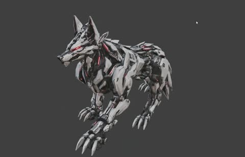

[← 返回图库](../browse/characters.md) · [English](2103748758962102274.en.md)

# 机械狼的 Blender 绑定动画

**[ハヤシモン｜AI × 個人開発 · @hayashimon1](https://x.com/hayashimon1)** · 角色动画 · 10s

> 发现池 · 来源已核对，编目资料待完善。

**[▶ 打开画廊播放](https://guanmo-ai.github.io/awesome-ai-motion/#case-2103748758962102274)** · [作者原帖](https://x.com/hayashimon1/status/2103748758962102274)

点击封面打开画廊播放。

非人形机械狼通过绑定与动作编排展示角色运动。

未取得作者公开提示词。 [查看作者原帖](https://x.com/hayashimon1/status/2103748758962102274)

收藏 — · 点赞 — · 浏览 —

## 来源记录

- 作品原帖: [@hayashimon1](https://x.com/hayashimon1/status/2103748758962102274) · 2026-09-26T07:29:24+00:00
- 模型归因: Claude Opus 5.5 · [作者说明](https://x.com/hayashimon1/status/2103748758962102274)
- 提示词查阅记录: [作者原帖](https://x.com/hayashimon1/status/2103748758962102274) · 2026-11-02 09:52 UTC
- 封面来源: [原帖封面来源](https://x.com/hayashimon1/status/2103748758962102274) · 2.01s
- 互动快照: [X 原帖](https://x.com/hayashimon1/status/2103748758962102274) · 2026-11-02 09:19 UTC
- 画廊原视频: [原帖媒体记录](https://x.com/hayashimon1/status/2103748758962102274) · 2026-11-02 09:52 UTC · 已核对原帖媒体对应与媒体响应；外部引用，不重新上传

模型依据来自作者自述，未独立重跑提示词，也未对音画作统一质量评级。视频引用作者原帖媒体，未由本站重新上传，转载许可未确认。
