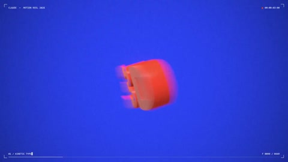

[← 返回图库](../browse/motion.md) · [English](2103766565389054427.en.md)

# Clawd 的立体旋转与粒子散开

**[FriskyGG · @FriskyGGG](https://x.com/FriskyGGG)** · 短动效 · 15s

> 发现池 · 来源已核对，编目资料待完善。

**[▶ 打开画廊播放](https://guanmo-ai.github.io/awesome-ai-motion/#case-2103766565389054427)** · [作者原帖](https://x.com/FriskyGGG/status/2103766565389054427)

点击封面打开画廊播放。

橙色立体吉祥物旋转入场，随后切换到密集粒子与几何运动，形成三维动效片段。

未取得作者公开提示词。 [查看作者原帖](https://x.com/FriskyGGG/status/2103766565389054427)

收藏 — · 点赞 2 · 浏览 —

## 来源记录

- 作品原帖: [@FriskyGGG](https://x.com/FriskyGGG/status/2103766565389054427) · 2026-09-26T08:40:09+00:00
- 模型归因: Claude Opus 5.5 · [作者说明](https://x.com/FriskyGGG/status/2103766565389054427)
- 提示词查阅记录: [作者原帖](https://x.com/FriskyGGG/status/2103766565389054427) · 2026-10-26 16:20 UTC
- 封面来源: [原帖封面来源](https://x.com/FriskyGGG/status/2103766565389054427) · 3s
- 互动快照: [X 原帖](https://x.com/FriskyGGG/status/2103766565389054427) · 2026-10-26 15:53 UTC
- 画廊原视频: [原帖媒体记录](https://x.com/FriskyGGG/status/2103766565389054427) · 2026-10-26 16:20 UTC · 已核对原帖媒体对应与媒体响应；外部引用，不重新上传

模型依据来自作者自述，未独立重跑提示词，也未对音画作统一质量评级。视频引用作者原帖媒体，未由本站重新上传，转载许可未确认。
