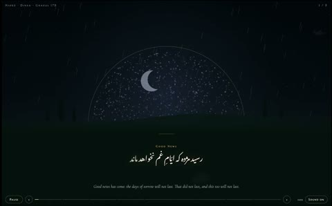

[← 返回图库](../browse/music.md) · [English](2103784499125559530.en.md)

# 波斯诗中的月亮与粒子苍穹

**[Kimia 🐙 · @kimziify](https://x.com/kimziify)** · 音乐与歌词 · 16s

> 发现池 · 来源已核对，编目资料待完善。

**[▶ 打开画廊播放](https://guanmo-ai.github.io/awesome-ai-motion/#case-2103784499125559530)** · [作者原帖](https://x.com/kimziify/status/2103784499125559530)

点击封面打开画廊播放。

[作者的诗歌可视化合集](https://kimzify.github.io/naqsh-e-khiyal/) · [诗歌动画与合成音乐项目源码](https://github.com/Kimzify/naqsh-e-khiyal)

月亮、柏树剪影与粒子圆顶随诗句显现，营造带双语文字的夜间诗歌可视化。

## 源码与网页

- **公开网页**：[作者的诗歌可视化合集](https://kimzify.github.io/naqsh-e-khiyal/)
  [链接出处](https://x.com/kimziify/status/2103784499125559530) · 链接核对 2026-10-26 15:15 UTC
- **直接源码**：[诗歌动画与合成音乐项目源码](https://github.com/Kimzify/naqsh-e-khiyal) · [MIT](https://github.com/Kimzify/naqsh-e-khiyal/blob/main/LICENSE)
  代码采用 MIT；译文、场景设计、音乐与预览图另采用 CC BY 4.0，详见仓库 LICENSE-CONTENT.md；字体遵循各自许可。
  [链接出处](https://x.com/kimziify/status/2103784499125559530) · 链接核对 2026-10-26 15:15 UTC

## 可以借鉴什么

按诗句拆场景，让画面和合成音乐围绕同一意象展开。

**开始尝试** · 根据作者公开资料整理的编辑建议，并非作者完整操作记录。

1. 为每个诗句写独立的 Canvas 时间函数。
2. 按诗的意象组织转场、文字显现与可定位的播放时间。
3. 用 Web Audio 合成乐器，并按代码与内容的不同许可复用。

原文提到的工具：Canvas · Web Audio API · JavaScript

[资料出处 1](https://x.com/kimziify/status/2103784499125559530) · [资料出处 2](https://github.com/Kimzify/naqsh-e-khiyal)

未取得作者公开提示词。 [查看作者原帖](https://x.com/kimziify/status/2103784499125559530)

收藏 — · 点赞 236 · 浏览 —

## 来源记录

- 作品原帖: [@kimziify](https://x.com/kimziify/status/2103784499125559530) · 2026-09-26T09:51:25+00:00
- 模型归因: Claude Opus 5.5 · [作者说明](https://x.com/kimziify/status/2103784499125559530)
- 提示词查阅记录: [作者原帖](https://x.com/kimziify/status/2103784499125559530) · 2026-10-26 15:21 UTC
- 封面来源: [原帖封面来源](https://x.com/kimziify/status/2103784499125559530) · 3.2s
- 互动快照: [X 原帖](https://x.com/kimziify/status/2103784499125559530) · 2026-10-26 15:01 UTC
- 画廊原视频: [原帖媒体记录](https://x.com/kimziify/status/2103784499125559530) · 2026-10-26 15:21 UTC · 已核对原帖媒体对应与媒体响应；外部引用，不重新上传

模型依据来自作者自述，未独立重跑提示词，也未对音画作统一质量评级。视频引用作者原帖媒体，未由本站重新上传，转载许可未确认。

原帖包含 3 个视频，本封面对应第一条。
