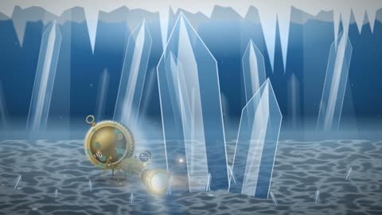

[← Back to gallery](../browse/stories.en.md) · [简体中文](2103793820815245507.md)

# A Mechanical Hermit Crab Follows a Light

**[嘉佬Lief · @liefmusk](https://x.com/liefmusk)** · Narrative films · 50s

> Discovery pool · Source verified; catalog details being completed.

**[▶ Open gallery to play](https://guanmo-ai.github.io/awesome-ai-motion/?lang=en#case-2103793820815245507)** · [Original post](https://x.com/liefmusk/status/2103793820815245507)

Click the cover to open the gallery and play.

A mechanical hermit crab crosses deep-sea crystals and light, connecting what it follows with itself.

No public prompt has been verified. [View the original post](https://x.com/liefmusk/status/2103793820815245507)

Bookmarks — · Likes — · Views —

## Source record

- Original post: [@liefmusk](https://x.com/liefmusk/status/2103793820815245507) · 2026-09-26T10:28:28+00:00
- Model attribution: Claude Opus 5.5 · [Creator’s statement](https://x.com/liefmusk/status/2103793820815245507)
- Prompt lookup: [Creator post](https://x.com/liefmusk/status/2103793820815245507) · 2026-11-02 09:52 UTC
- Cover source: [Original cover source](https://x.com/liefmusk/status/2103793820815245507) · 10.01s
- Metrics snapshot: [Original X post](https://x.com/liefmusk/status/2103793820815245507) · 2026-11-02 09:13 UTC
- Gallery video source: [Original post media record](https://x.com/liefmusk/status/2103793820815245507) · 2026-11-02 09:52 UTC · Post/media correspondence and media response checked; external reference, no re-upload

Model attribution is based on creator statements. Prompts have not been independently rerun; sound and visuals have not received a uniform quality rating. Videos reference original post media, not our uploads; redistribution permission has not been verified.
