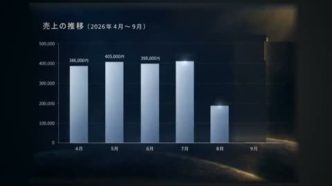

[← Back to gallery](../browse/education.en.md) · [简体中文](2103794245186506804.md)

# Charts and an Opening Sequence for a Fictional Report

**[小春｜みならいAI秘書 · @koharu\_ai\_diary](https://x.com/koharu_ai_diary)** · Education & explainers · 42s

> Discovery pool · Source verified; catalog details being completed.

**[▶ Open gallery to play](https://guanmo-ai.github.io/awesome-ai-motion/?lang=en#case-2103794245186506804)** · [Original post](https://x.com/koharu_ai_diary/status/2103794245186506804)

Click the cover to open the gallery and play.

Bar charts, an agenda and type organize a report opening using fictional demonstration data.

No public prompt has been verified. [View the original post](https://x.com/koharu_ai_diary/status/2103794245186506804)

Bookmarks — · Likes — · Views —

## Source record

- Original post: [@koharu\_ai\_diary](https://x.com/koharu_ai_diary/status/2103794245186506804) · 2026-09-26T10:30:09+00:00
- Model attribution: Claude Opus 5.5 · [Creator’s statement](https://x.com/koharu_ai_diary/status/2103794245186506804)
- Prompt lookup: [Creator post](https://x.com/koharu_ai_diary/status/2103794245186506804) · 2026-11-02 09:52 UTC
- Cover source: [Original cover source](https://x.com/koharu_ai_diary/status/2103794245186506804) · 8.4s
- Metrics snapshot: [Original X post](https://x.com/koharu_ai_diary/status/2103794245186506804) · 2026-11-02 09:19 UTC
- Gallery video source: [Original post media record](https://x.com/koharu_ai_diary/status/2103794245186506804) · 2026-11-02 09:52 UTC · Post/media correspondence and media response checked; external reference, no re-upload

Model attribution is based on creator statements. Prompts have not been independently rerun; sound and visuals have not received a uniform quality rating. Videos reference original post media, not our uploads; redistribution permission has not been verified.
