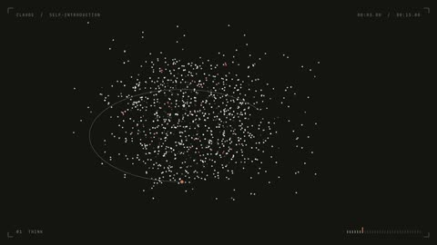

[← 返回图库](../browse/motion.md) · [English](2103802156675706979.en.md)

# Claude 自我介绍的文字与粒子

**[タナベ \| AI動画 × マーケティング · @tanabe\_fragm](https://x.com/tanabe_fragm)** · 短动效 · 15s

> 发现池 · 来源已核对，编目资料待完善。

**[▶ 打开画廊播放](https://guanmo-ai.github.io/awesome-ai-motion/#case-2103802156675706979)** · [作者原帖](https://x.com/tanabe_fragm/status/2103802156675706979)

点击封面打开画廊播放。

衬线文字、标记和粒子球在橙黑画面间切换，以不同图形段落构成模型的自我介绍。

作者已公开指令；本站仅提供原帖入口，不再分发全文或译文。 [查看作者原文](https://x.com/tanabe_fragm/status/2103802156675706979)

收藏 — · 点赞 30 · 浏览 —

## 来源记录

- 作品原帖: [@tanabe\_fragm](https://x.com/tanabe_fragm/status/2103802156675706979) · 2026-09-26T11:01:35+00:00
- 模型归因: Claude Opus 5.5 · [作者说明](https://x.com/tanabe_fragm/status/2103802156675706979)
- 提示词出处: [作者原帖](https://x.com/tanabe_fragm/status/2103802156675706979) · 2026-10-26 15:21 UTC
- 封面来源: [原帖封面来源](https://x.com/tanabe_fragm/status/2103802156675706979) · 3s
- 互动快照: [X 原帖](https://x.com/tanabe_fragm/status/2103802156675706979) · 2026-10-26 15:01 UTC
- 画廊原视频: [原帖媒体记录](https://x.com/tanabe_fragm/status/2103802156675706979) · 2026-10-26 15:21 UTC · 已核对原帖媒体对应与媒体响应；外部引用，不重新上传

模型依据来自作者自述，未独立重跑提示词，也未对音画作统一质量评级。视频引用作者原帖媒体，未由本站重新上传，转载许可未确认。
