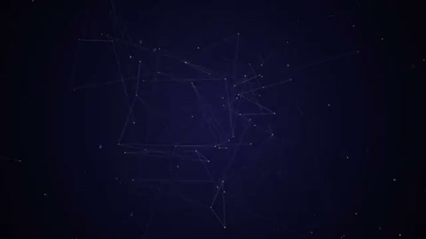

[← Back to gallery](../browse/product.en.md) · [简体中文](2103802871934497266.md)

# PaymentForm's Line-Built Mark

**[Abdul kaioum · @Mounnna](https://x.com/Mounnna)** · Product & marketing · 16s

> Discovery pool · Source verified; catalog details being completed.

**[▶ Open gallery to play](https://guanmo-ai.github.io/awesome-ai-motion/?lang=en#case-2103802871934497266)** · [Original post](https://x.com/Mounnna/status/2103802871934497266)

Click the cover to open the gallery and play.

Lines and geometric fragments gather on a dark background to reveal a brand mark and typography.

No public prompt has been verified. [View the original post](https://x.com/Mounnna/status/2103802871934497266)

Bookmarks 0 · Likes 2 · Views 188

## Source record

- Original post: [@Mounnna](https://x.com/Mounnna/status/2103802871934497266) · 2026-09-26T11:04:26+00:00
- Model attribution: Claude Opus 5.5 · [Creator’s statement](https://x.com/Mounnna/status/2103802871934497266)
- Prompt lookup: [Creator post](https://x.com/Mounnna/status/2103802871934497266) · 2026-10-24 12:20 UTC
- Cover source: [Original cover source](https://x.com/Mounnna/status/2103802871934497266) · 3.2s
- Metrics snapshot: [Original X post](https://x.com/Mounnna/status/2103802871934497266) · 2026-10-24 12:20 UTC
- Gallery video source: [Original post media record](https://x.com/Mounnna/status/2103802871934497266) · 2026-10-24 12:20 UTC · Post/media correspondence and media response checked; external reference, no re-upload

Model attribution is based on creator statements. Prompts have not been independently rerun; sound and visuals have not received a uniform quality rating. Videos reference original post media, not our uploads; redistribution permission has not been verified.
