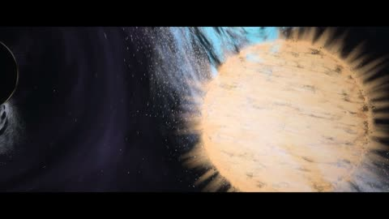

[← Back to gallery](../browse/interactive.en.md) · [简体中文](2103816126778003746.md)

# Particles in a Star's Encounter with a Black Hole

**[adi · @adonis\_singh](https://x.com/adonis_singh)** · 3D & interactive · 28s

> Discovery pool · Source verified; catalog details being completed.

**[▶ Open gallery to play](https://guanmo-ai.github.io/awesome-ai-motion/?lang=en#case-2103816126778003746)** · [Original post](https://x.com/adonis_singh/status/2103816126778003746)

Click the cover to open the gallery and play.

A star approaches an accretion disk in dark space as luminous particles stretch into streams in a code-built celestial scene.

No public prompt has been verified. [View the original post](https://x.com/adonis_singh/status/2103816126778003746)

Bookmarks — · Likes 167 · Views —

## Source record

- Original post: [@adonis\_singh](https://x.com/adonis_singh/status/2103816126778003746) · 2026-09-26T11:57:06+00:00
- Model attribution: Claude Opus 5.5 · [Creator’s statement](https://x.com/adonis_singh/status/2103816126778003746)
- Prompt lookup: [Creator post](https://x.com/adonis_singh/status/2103816126778003746) · 2026-10-26 15:21 UTC
- Cover source: [Original cover source](https://x.com/adonis_singh/status/2103816126778003746) · 5.6s
- Metrics snapshot: [Original X post](https://x.com/adonis_singh/status/2103816126778003746) · 2026-10-26 15:01 UTC
- Gallery video source: [Original post media record](https://x.com/adonis_singh/status/2103816126778003746) · 2026-10-26 15:21 UTC · Post/media correspondence and media response checked; external reference, no re-upload

Model attribution is based on creator statements. Prompts have not been independently rerun; sound and visuals have not received a uniform quality rating. Videos reference original post media, not our uploads; redistribution permission has not been verified.
