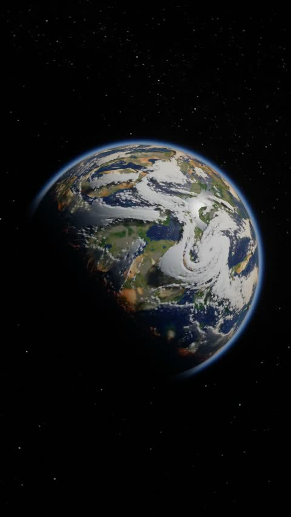

[← Back to gallery](../browse/interactive.en.md) · [简体中文](2103837519615774895.md)

# Words Become Live Particles and Sound

**[Mia · @MiaAI\_lab](https://x.com/MiaAI_lab)** · 3D & interactive · 97s

> Discovery pool · Source verified; catalog details being completed.

**[▶ Open gallery to play](https://guanmo-ai.github.io/awesome-ai-motion/?lang=en#case-2103837519615774895)** · [Original post](https://x.com/MiaAI_lab/status/2103837519615774895)

Click the cover to open the gallery and play.

Typed words trigger particles, planets and sound, generated live in code according to the creator.

No public prompt has been verified. [View the original post](https://x.com/MiaAI_lab/status/2103837519615774895)

Bookmarks — · Likes — · Views —

## Source record

- Original post: [@MiaAI\_lab](https://x.com/MiaAI_lab/status/2103837519615774895) · 2026-09-26T13:22:06+00:00
- Model attribution: Claude Opus 5.5 · [Creator’s statement](https://x.com/MiaAI_lab/status/2103837519615774895)
- Prompt lookup: [Creator post](https://x.com/MiaAI_lab/status/2103837519615774895) · 2026-11-02 15:38 UTC
- Cover source: [Original cover source](https://x.com/MiaAI_lab/status/2103837519615774895) · 67.93s
- Metrics snapshot: [Original X post](https://x.com/MiaAI_lab/status/2103837519615774895) · 2026-11-02 15:05 UTC
- Gallery video source: [Original post media record](https://x.com/MiaAI_lab/status/2103837519615774895) · 2026-11-02 15:38 UTC · Post/media correspondence and media response checked; external reference, no re-upload

Model attribution is based on creator statements. Prompts have not been independently rerun; sound and visuals have not received a uniform quality rating. Videos reference original post media, not our uploads; redistribution permission has not been verified.
