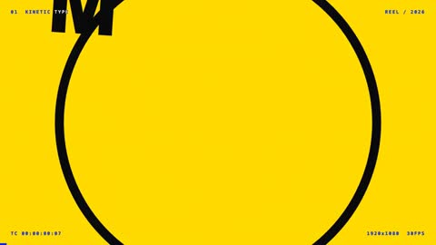

[← 返回图库](../browse/motion.md) · [English](2103878567540961335.en.md)

# 黑白粉黄的动态图形作品集

**[AI Chris Lee \| Sell AI · @aichrislee](https://x.com/aichrislee)** · 短动效 · 19s

> 发现池 · 来源已核对，编目资料待完善。

**[▶ 打开画廊播放](https://guanmo-ai.github.io/awesome-ai-motion/#case-2103878567540961335)** · [作者原帖](https://x.com/aichrislee/status/2103878567540961335)

点击封面打开画廊播放。

粗体文字、圆环和重复排版以快速缩放与遮罩切换，组成高对比的动态图形作品集。

## 可以借鉴什么

把动画定义为时间的函数，再逐帧导出可重复的画面。

**开始尝试** · 根据作者公开资料整理的编辑建议，并非作者完整操作记录。

1. 先约定画幅、时长与大字、色块、镜头移动的视觉方向。
2. 用单个 HTML 文件按时间绘制每一帧。
3. 用 Playwright 输出帧，再用 FFmpeg 合成为视频。

原文提到的工具：Opus 5.5 · HTML · Playwright · FFmpeg

[资料出处 1](https://x.com/aichrislee/status/2103878567540961335)

作者已公开指令；本站仅提供原帖入口，不再分发全文或译文。 [查看作者原文](https://x.com/aichrislee/status/2103878567540961335)

收藏 — · 点赞 0 · 浏览 —

## 来源记录

- 作品原帖: [@aichrislee](https://x.com/aichrislee/status/2103878567540961335) · 2026-09-26T16:05:13+00:00
- 模型归因: Claude Opus 5.5 · [作者说明](https://x.com/aichrislee/status/2103878567540961335)
- 提示词出处: [作者原帖](https://x.com/aichrislee/status/2103878567540961335) · 2026-10-26 15:21 UTC
- 封面来源: [原帖封面来源](https://x.com/aichrislee/status/2103878567540961335) · 3.71s
- 互动快照: [X 原帖](https://x.com/aichrislee/status/2103878567540961335) · 2026-10-26 14:57 UTC
- 画廊原视频: [原帖媒体记录](https://x.com/aichrislee/status/2103878567540961335) · 2026-10-26 15:21 UTC · 已核对原帖媒体对应与媒体响应；外部引用，不重新上传

模型依据来自作者自述，未独立重跑提示词，也未对音画作统一质量评级。视频引用作者原帖媒体，未由本站重新上传，转载许可未确认。
