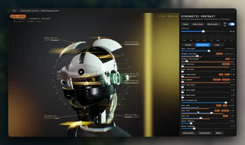

[← Back to gallery](../browse/interactive.en.md) · [简体中文](2103887665305391343.md)

# A Mechanical Head Responding to Music

**[Zsolt Kacso · @kaolti](https://x.com/kaolti)** · 3D & interactive · 28s

> Discovery pool · Source verified; catalog details being completed.

**[▶ Open gallery to play](https://guanmo-ai.github.io/awesome-ai-motion/?lang=en#case-2103887665305391343)** · [Original post](https://x.com/kaolti/status/2103887665305391343)

Click the cover to open the gallery and play.

Shells, lighting and components of a metal head change within a music-visualization interface, forming an adjustable 3D portrait.

No public prompt has been verified. [View the original post](https://x.com/kaolti/status/2103887665305391343)

Bookmarks — · Likes 1,766 · Views —

## Source record

- Original post: [@kaolti](https://x.com/kaolti/status/2103887665305391343) · 2026-09-26T16:41:22+00:00
- Model attribution: Claude Opus 5.5 · [Creator’s statement](https://x.com/kaolti/status/2103887665305391343)
- Prompt lookup: [Creator post](https://x.com/kaolti/status/2103887665305391343) · 2026-10-26 15:21 UTC
- Cover source: [Original cover source](https://x.com/kaolti/status/2103887665305391343) · 5.61s
- Metrics snapshot: [Original X post](https://x.com/kaolti/status/2103887665305391343) · 2026-10-26 14:57 UTC
- Gallery video source: [Original post media record](https://x.com/kaolti/status/2103887665305391343) · 2026-10-26 15:21 UTC · Post/media correspondence and media response checked; external reference, no re-upload

Model attribution is based on creator statements. Prompts have not been independently rerun; sound and visuals have not received a uniform quality rating. Videos reference original post media, not our uploads; redistribution permission has not been verified.
