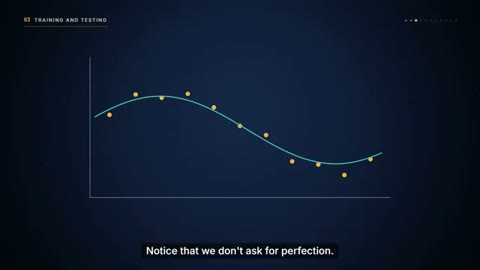

[← 返回图库](../browse/education.md) · [English](2104023028481077357.en.md)

# 从数据曲线到神经网络

**[皓樂芒 · @howlemont](https://x.com/howlemont)** · 知识讲解 · 507s

> 发现池 · 来源已核对，编目资料待完善。

**[▶ 打开画廊播放](https://guanmo-ai.github.io/awesome-ai-motion/#case-2104023028481077357)** · [作者原帖](https://x.com/howlemont/status/2104023028481077357)

点击封面打开画廊播放。

散点、曲线与网络节点分步展开，配合字幕解释训练与优化主题；作者说明参考线性代数教材内容，让 Opus 5.5 制作讲解。

作者已公开指令；本站仅提供原帖入口，不再分发全文或译文。 [查看作者原文](https://x.com/howlemont/status/2104023736370503897)

收藏 0 · 点赞 0 · 浏览 769

## 来源记录

- 作品原帖: [@howlemont](https://x.com/howlemont/status/2104023028481077357) · 2026-09-27T01:39:15+00:00
- 模型归因: Claude Opus 5.5 · [作者说明](https://x.com/howlemont/status/2104023028481077357)
- 提示词出处: [作者原帖](https://x.com/howlemont/status/2104023736370503897) · 2026-10-22 10:31 UTC
- 封面来源: [原帖封面来源](https://x.com/howlemont/status/2104023028481077357) · 101.47s
- 互动快照: [X 原帖](https://x.com/howlemont/status/2104023028481077357) · 2026-10-22 10:31 UTC
- 画廊原视频: [原帖媒体记录](https://x.com/howlemont/status/2104023028481077357) · 2026-10-22 10:31 UTC · 已核对原帖媒体对应与媒体响应；外部引用，不重新上传

模型依据来自作者自述，未独立重跑提示词，也未对音画作统一质量评级。视频引用作者原帖媒体，未由本站重新上传，转载许可未确认。
