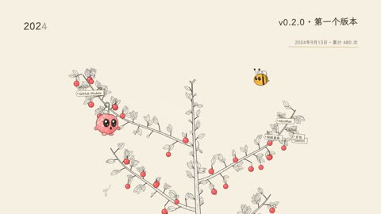

[← 返回图库](../browse/stories.md) · [English](2104037017873162442.en.md)

# Cherry Studio 樱桃树的成长故事

**[海拉鲁编程客 · @hylarucoder](https://x.com/hylarucoder)** · 叙事短片 · 133s

> 发现池 · 来源已核对，编目资料待完善。

**[▶ 打开画廊播放](https://guanmo-ai.github.io/awesome-ai-motion/#case-2104037017873162442)** · [作者原帖](https://x.com/hylarucoder/status/2104037017873162442)

点击封面打开画廊播放。

[git-story-film 通用制作 Skill](https://github.com/EverMind-AI/Raven/tree/main/skills/git-story-film)

樱桃树向上生长，以叶子、花朵、果实和蜜蜂映射提交、功能、版本与贡献者。

## 源码与网页

- **相关工具**：[git-story-film 通用制作 Skill](https://github.com/EverMind-AI/Raven/tree/main/skills/git-story-film) · [Apache-2.0](https://github.com/EverMind-AI/Raven/blob/main/LICENSE)
  Raven 仓库代码采用 Apache-2.0；改编自 Alexey Fateev 的绘图引擎另保留 MIT 许可。通用工具不等于本片完整工程。
  [链接出处](https://x.com/hylarucoder/status/2104076282107723935) · 链接核对 2026-11-02 09:52 UTC

未取得作者公开提示词。 [查看作者原帖](https://x.com/hylarucoder/status/2104037017873162442)

收藏 — · 点赞 — · 浏览 —

## 来源记录

- 作品原帖: [@hylarucoder](https://x.com/hylarucoder/status/2104037017873162442) · 2026-09-27T02:34:50+00:00
- 模型归因: Claude Opus 5.5 · [作者说明](https://x.com/hylarucoder/status/2104076282107723935)
- 提示词查阅记录: [作者原帖](https://x.com/hylarucoder/status/2104037017873162442) · 2026-11-02 09:52 UTC
- 封面来源: [原帖封面来源](https://x.com/hylarucoder/status/2104037017873162442) · 26.62s
- 互动快照: [X 原帖](https://x.com/hylarucoder/status/2104037017873162442) · 2026-11-02 09:30 UTC
- 画廊原视频: [原帖媒体记录](https://x.com/hylarucoder/status/2104037017873162442) · 2026-11-02 09:52 UTC · 已核对原帖媒体对应与媒体响应；外部引用，不重新上传

模型依据来自作者自述，未独立重跑提示词，也未对音画作统一质量评级。视频引用作者原帖媒体，未由本站重新上传，转载许可未确认。
