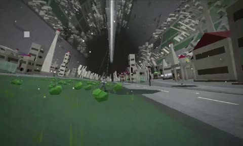

[← Back to gallery](../browse/interactive.en.md) · [简体中文](2104046074600272056.md)

# Procedural Streets in Endless Space Colonies

**[timothée chalabi · @smallhusk](https://x.com/smallhusk)** · 3D & interactive · 49s

> Discovery pool · Source verified; catalog details being completed.

**[▶ Open gallery to play](https://guanmo-ai.github.io/awesome-ai-motion/?lang=en#case-2104046074600272056)** · [Original post](https://x.com/smallhusk/status/2104046074600272056)

Click the cover to open the gallery and play.

The camera travels through dense geometric buildings and streets in a procedurally generated space-colony environment.

No public prompt has been verified. [View the original post](https://x.com/smallhusk/status/2104046074600272056)

Bookmarks — · Likes 3 · Views —

## Source record

- Original post: [@smallhusk](https://x.com/smallhusk/status/2104046074600272056) · 2026-09-27T03:10:50+00:00
- Model attribution: Claude Opus 5.5 · [Creator’s statement](https://x.com/smallhusk/status/2104046074600272056)
- Prompt lookup: [Creator post](https://x.com/smallhusk/status/2104046074600272056) · 2026-10-26 15:21 UTC
- Cover source: [Original cover source](https://x.com/smallhusk/status/2104046074600272056) · 9.79s
- Metrics snapshot: [Original X post](https://x.com/smallhusk/status/2104046074600272056) · 2026-10-26 14:57 UTC
- Gallery video source: [Original post media record](https://x.com/smallhusk/status/2104046074600272056) · 2026-10-26 15:21 UTC · Post/media correspondence and media response checked; external reference, no re-upload

Model attribution is based on creator statements. Prompts have not been independently rerun; sound and visuals have not received a uniform quality rating. Videos reference original post media, not our uploads; redistribution permission has not been verified.
