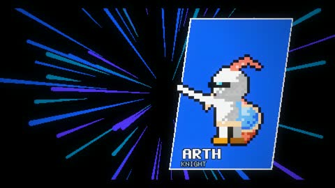

[← Back to gallery](../browse/music.en.md) · [简体中文](2104048491295318358.md)

# 8-Bit RPG Music and Graphic Beats

**[ギガビット@ゲームつくるひと · @gigabit\_million](https://x.com/gigabit_million)** · Music & lyrics · 60s

> Discovery pool · Source verified; catalog details being completed.

**[▶ Open gallery to play](https://guanmo-ai.github.io/awesome-ai-motion/?lang=en#case-2104048491295318358)** · [Original post](https://x.com/gigabit_million/status/2104048491295318358)

Click the cover to open the gallery and play.

Wizards, aircraft and 8-bit graphics change alongside game-battle music.

The creator has shared instructions; this catalog links to the source without redistributing the full text or translation. [Read the creator’s original](https://x.com/gigabit_million/status/2104048491295318358)

Bookmarks — · Likes — · Views —

## Source record

- Original post: [@gigabit\_million](https://x.com/gigabit_million/status/2104048491295318358) · 2026-09-27T03:20:26+00:00
- Model attribution: Claude Opus 5.5 · [Creator’s statement](https://x.com/gigabit_million/status/2104048491295318358)
- Prompt source: [Creator post](https://x.com/gigabit_million/status/2104048491295318358) · 2026-11-02 09:52 UTC
- Cover source: [Original cover source](https://x.com/gigabit_million/status/2104048491295318358) · 12.01s
- Metrics snapshot: [Original X post](https://x.com/gigabit_million/status/2104048491295318358) · 2026-11-02 09:18 UTC
- Gallery video source: [Original post media record](https://x.com/gigabit_million/status/2104048491295318358) · 2026-11-02 09:52 UTC · Post/media correspondence and media response checked; external reference, no re-upload

Model attribution is based on creator statements. Prompts have not been independently rerun; sound and visuals have not received a uniform quality rating. Videos reference original post media, not our uploads; redistribution permission has not been verified.
