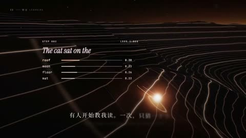

[← Back to gallery](../browse/education.en.md) · [简体中文](2104060535415476361.md)

# A Graphic Short about Code Explaining Itself

**[Andy L · @AndyL5cc](https://x.com/AndyL5cc)** · Education & explainers · 168s

> Discovery pool · Source verified; catalog details being completed.

**[▶ Open gallery to play](https://guanmo-ai.github.io/awesome-ai-motion/?lang=en#case-2104060535415476361)** · [Original post](https://x.com/AndyL5cc/status/2104060535415476361)

Click the cover to open the gallery and play.

Typography, contour lines and a glowing globe transition through a graphic narrative about code and expression.

No public prompt has been verified. [View the original post](https://x.com/AndyL5cc/status/2104060535415476361)

Bookmarks — · Likes 167 · Views —

## Source record

- Original post: [@AndyL5cc](https://x.com/AndyL5cc/status/2104060535415476361) · 2026-09-27T04:08:17+00:00
- Model attribution: Claude Opus 5.5 · [Creator’s statement](https://x.com/AndyL5cc/status/2104060535415476361)
- Prompt lookup: [Creator post](https://x.com/AndyL5cc/status/2104060535415476361) · 2026-10-26 15:21 UTC
- Cover source: [Original cover source](https://x.com/AndyL5cc/status/2104060535415476361) · 33.6s
- Metrics snapshot: [Original X post](https://x.com/AndyL5cc/status/2104060535415476361) · 2026-10-26 14:57 UTC
- Gallery video source: [Original post media record](https://x.com/AndyL5cc/status/2104060535415476361) · 2026-10-26 15:21 UTC · Post/media correspondence and media response checked; external reference, no re-upload

Model attribution is based on creator statements. Prompts have not been independently rerun; sound and visuals have not received a uniform quality rating. Videos reference original post media, not our uploads; redistribution permission has not been verified.
