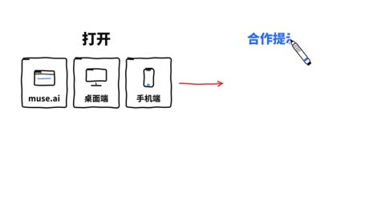

[← Back to gallery](../browse/education.en.md) · [简体中文](2104119716533178533.md)

# An AI Article Explained with Hand-Drawn Arrows

**[蓝哥AI · @0xlangeai](https://x.com/0xlangeai)** · Education & explainers · 56s

> Discovery pool · Source verified; catalog details being completed.

**[▶ Open gallery to play](https://guanmo-ai.github.io/awesome-ai-motion/?lang=en#case-2104119716533178533)** · [Original post](https://x.com/0xlangeai/status/2104119716533178533)

Click the cover to open the gallery and play.

Hand-drawn arrows connect browsers, files, a magnifying glass and chat bubbles in a progressively drawn article explainer.

No public prompt has been verified. [View the original post](https://x.com/0xlangeai/status/2104119716533178533)

Bookmarks 8 · Likes 4 · Views 4,862

## Source record

- Original post: [@0xlangeai](https://x.com/0xlangeai/status/2104119716533178533) · 2026-09-27T08:03:27+00:00
- Model attribution: Claude Opus 5.5 · [Creator’s statement](https://x.com/0xlangeai/status/2104119716533178533)
- Prompt lookup: [Creator post](https://x.com/0xlangeai/status/2104119716533178533) · 2026-10-23 05:30 UTC
- Cover source: [Original cover source](https://x.com/0xlangeai/status/2104119716533178533) · 11.2s
- Metrics snapshot: [Original X post](https://x.com/0xlangeai/status/2104119716533178533) · 2026-10-23 05:30 UTC
- Gallery video source: [Original post media record](https://x.com/0xlangeai/status/2104119716533178533) · 2026-10-23 05:30 UTC · Post/media correspondence and media response checked; external reference, no re-upload

Model attribution is based on creator statements. Prompts have not been independently rerun; sound and visuals have not received a uniform quality rating. Videos reference original post media, not our uploads; redistribution permission has not been verified.
