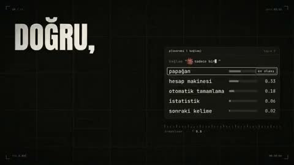

[← 返回图库](../browse/music.md) · [English](2104131419853160477.en.md)

# 下一个词：黄色角色的土耳其语 MV

**[Avenox · @Avenoxai](https://x.com/Avenoxai)** · 音乐与歌词 · 193s

> 发现池 · 来源已核对，编目资料待完善。

**[▶ 打开画廊播放](https://guanmo-ai.github.io/awesome-ai-motion/#case-2104131419853160477)** · [作者原帖](https://x.com/Avenoxai/status/2104131419853160477)

点击封面打开画廊播放。

黄色卡通角色、候选词列表和大字歌词交替出现，将模型自述写成带有图形比喻的音乐短片。

未取得作者公开提示词。 [查看作者原帖](https://x.com/Avenoxai/status/2104131419853160477)

收藏 1,158 · 点赞 2,088 · 浏览 329,967

## 来源记录

- 作品原帖: [@Avenoxai](https://x.com/Avenoxai/status/2104131419853160477) · 2026-09-27T08:49:58+00:00
- 模型归因: Claude Opus 5.5 · [作者说明](https://x.com/Avenoxai/status/2104131419853160477)
- 提示词查阅记录: [作者原帖](https://x.com/Avenoxai/status/2104131419853160477) · 2026-10-23 05:30 UTC
- 封面来源: [原帖封面来源](https://x.com/Avenoxai/status/2104131419853160477) · 38.51s
- 互动快照: [X 原帖](https://x.com/Avenoxai/status/2104131419853160477) · 2026-10-23 05:30 UTC
- 画廊原视频: [原帖媒体记录](https://x.com/Avenoxai/status/2104131419853160477) · 2026-10-23 05:30 UTC · 已核对原帖媒体对应与媒体响应；外部引用，不重新上传

模型依据来自作者自述，未独立重跑提示词，也未对音画作统一质量评级。视频引用作者原帖媒体，未由本站重新上传，转载许可未确认。
