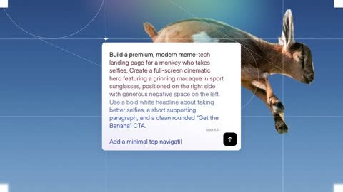

[← Back to gallery](../browse/product.en.md) · [简体中文](2104138101102621133.md)

# Monke: from prompt box to full-page reveal

**[dawood46 · @notdwd](https://x.com/notdwd)** · Product & marketing · 8s

> Discovery pool · Source verified; catalog details being completed.

**[▶ Open gallery to play](https://guanmo-ai.github.io/awesome-ai-motion/?lang=en#case-2104138101102621133)** · [Original post](https://x.com/notdwd/status/2104138101102621133)

Click the cover to open the gallery and play.

Text types into a prompt box that expands into a monkey-themed landing page, with images, headings and buttons transforming in a continuous shot.

The creator has shared instructions; this catalog links to the source without redistributing the full text or translation. [Read the creator’s original](https://x.com/notdwd/status/2104138101102621133)

Bookmarks — · Likes — · Views —

## Source record

- Original post: [@notdwd](https://x.com/notdwd/status/2104138101102621133) · 2026-09-27T09:16:30.000Z
- Model attribution: Claude Opus 5.5 · [Creator’s statement](https://x.com/notdwd/status/2104138101102621133)
- Prompt source: [Creator post](https://x.com/notdwd/status/2104138101102621133) · 2026-11-09 10:53 UTC
- Cover source: [Original cover source](https://x.com/notdwd/status/2104138101102621133) · 1.52s
- Metrics snapshot: [Original X post](https://x.com/notdwd/status/2104138101102621133) · 2026-11-09 10:43 UTC
- Gallery video source: [Original post media record](https://x.com/notdwd/status/2104138101102621133) · 2026-11-09 10:53 UTC · Post/media correspondence and media response checked; external reference, no re-upload

Model attribution is based on creator statements. Prompts have not been independently rerun; sound and visuals have not received a uniform quality rating. Videos reference original post media, not our uploads; redistribution permission has not been verified.
