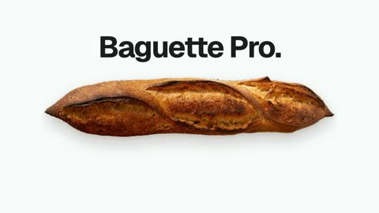

[← Back to gallery](../browse/product.en.md) · [简体中文](2104178266990858739.md)

# Baguette Pro: A Bread Concept Ad

**[Raphael aubry · @RaphaelAubryy](https://x.com/RaphaelAubryy)** · Product & marketing · 20s

> Discovery pool · Source verified; catalog details being completed.

**[▶ Open gallery to play](https://guanmo-ai.github.io/awesome-ai-motion/?lang=en#case-2104178266990858739)** · [Original post](https://x.com/RaphaelAubryy/status/2104178266990858739)

Click the cover to open the gallery and play.

A baguette, slices and product-style titles form a humorous technology-launch parody.

No public prompt has been verified. [View the original post](https://x.com/RaphaelAubryy/status/2104178266990858739)

Bookmarks — · Likes — · Views —

## Source record

- Original post: [@RaphaelAubryy](https://x.com/RaphaelAubryy/status/2104178266990858739) · 2026-09-27T11:56:07+00:00
- Model attribution: Claude Opus 5.5 · [Creator’s statement](https://x.com/RaphaelAubryy/status/2104178266990858739)
- Prompt lookup: [Creator post](https://x.com/RaphaelAubryy/status/2104178266990858739) · 2026-11-02 15:38 UTC
- Cover source: [Original cover source](https://x.com/RaphaelAubryy/status/2104178266990858739) · 4.01s
- Metrics snapshot: [Original X post](https://x.com/RaphaelAubryy/status/2104178266990858739) · 2026-11-02 15:08 UTC
- Gallery video source: [Original post media record](https://x.com/RaphaelAubryy/status/2104178266990858739) · 2026-11-02 15:38 UTC · Post/media correspondence and media response checked; external reference, no re-upload

Model attribution is based on creator statements. Prompts have not been independently rerun; sound and visuals have not received a uniform quality rating. Videos reference original post media, not our uploads; redistribution permission has not been verified.
