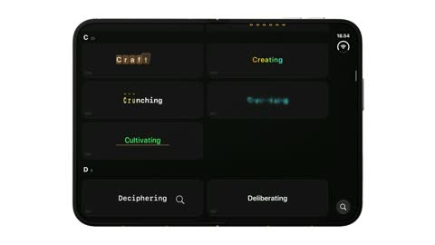

[← Back to gallery](../browse/motion.en.md) · [简体中文](2104216792877154656.md)

# A Collection of 184 SwiftUI Text Animations

**[Amos Gyamfi · @amos\_gyamfi](https://x.com/amos_gyamfi)** · Motion design · 275s

> Discovery pool · Source verified; catalog details being completed.

**[▶ Open gallery to play](https://guanmo-ai.github.io/awesome-ai-motion/?lang=en#case-2104216792877154656)** · [Original post](https://x.com/amos_gyamfi/status/2104216792877154656)

Click the cover to open the gallery and play.

[SwiftUI text-animation collection source](https://github.com/amosgyamfi/SwiftUI-Agent-Thinking-Text-Animations)

One demo presents many SwiftUI text animations with the creator's public code, catalogued as one collection.

## Source & web pages

- **Direct source**：[SwiftUI text-animation collection source](https://github.com/amosgyamfi/SwiftUI-Agent-Thinking-Text-Animations) · [MIT](https://github.com/amosgyamfi/SwiftUI-Agent-Thinking-Text-Animations/blob/main/LICENSE)
  The creator wrote two animations and asked Opus 5.5 to create the rest; this entry documents the collection.
  [Link source](https://x.com/amos_gyamfi/status/2104216792877154656) · Link checked 2026-11-02 09:52 UTC

No public prompt has been verified. [View the original post](https://x.com/amos_gyamfi/status/2104216792877154656)

Bookmarks — · Likes — · Views —

## Source record

- Original post: [@amos\_gyamfi](https://x.com/amos_gyamfi/status/2104216792877154656) · 2026-09-27T14:29:12+00:00
- Model attribution: Claude Opus 5.5 · [Creator’s statement](https://x.com/amos_gyamfi/status/2104216792877154656)
- Prompt lookup: [Creator post](https://x.com/amos_gyamfi/status/2104216792877154656) · 2026-11-02 09:52 UTC
- Cover source: [Original cover source](https://x.com/amos_gyamfi/status/2104216792877154656) · 55.04s
- Metrics snapshot: [Original X post](https://x.com/amos_gyamfi/status/2104216792877154656) · 2026-11-02 09:19 UTC
- Gallery video source: [Original post media record](https://x.com/amos_gyamfi/status/2104216792877154656) · 2026-11-02 09:52 UTC · Post/media correspondence and media response checked; external reference, no re-upload

Model attribution is based on creator statements. Prompts have not been independently rerun; sound and visuals have not received a uniform quality rating. Videos reference original post media, not our uploads; redistribution permission has not been verified.
