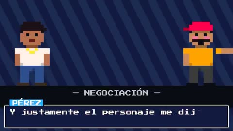

[← Back to gallery](../browse/characters.en.md) · [简体中文](2104225527401972058.md)

# Pixel Characters on Stage

**[Chapi · @chapi13](https://x.com/chapi13)** · Pixel art & characters · 75s

> Discovery pool · Source verified; catalog details being completed.

**[▶ Open gallery to play](https://guanmo-ai.github.io/awesome-ai-motion/?lang=en#case-2104225527401972058)** · [Original post](https://x.com/chapi13/status/2104225527401972058)

Click the cover to open the gallery and play.

Pixel characters, dialogue and stage changes recreate an internet story.

No public prompt has been verified. [View the original post](https://x.com/chapi13/status/2104225527401972058)

Bookmarks 0 · Likes 0 · Views 132

## Source record

- Original post: [@chapi13](https://x.com/chapi13/status/2104225527401972058) · 2026-09-27T15:03:55+00:00
- Model attribution: Opus 5.5 · [Creator’s statement](https://x.com/chapi13/status/2104225527401972058)
- Prompt lookup: [Creator post](https://x.com/chapi13/status/2104225527401972058) · 2026-10-16 07:20 UTC
- Cover source: [Original cover source](https://x.com/chapi13/status/2104225527401972058) · 15.01s
- Metrics snapshot: [Original X post](https://x.com/chapi13/status/2104225527401972058) · 2026-10-16 07:20 UTC
- Gallery video source: [Original post media record](https://x.com/chapi13/status/2104225527401972058) · 2026-10-16 07:20 UTC · Post/media correspondence and media response checked; external reference, no re-upload

Model attribution is based on creator statements. Prompts have not been independently rerun; sound and visuals have not received a uniform quality rating. Videos reference original post media, not our uploads; redistribution permission has not been verified.
