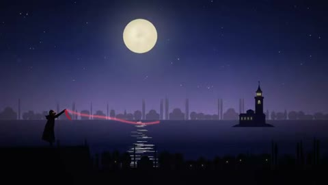

[← Back to gallery](../browse/music.en.md) · [简体中文](2104227002295140607.md)

# A Moonlit Silhouette Music Story

**[Yasin Özmen · @yasinozmeen](https://x.com/yasinozmeen)** · Music & lyrics · 193s

> Discovery pool · Source verified; catalog details being completed.

**[▶ Open gallery to play](https://guanmo-ai.github.io/awesome-ai-motion/?lang=en#case-2104227002295140607)** · [Original post](https://x.com/yasinozmeen/status/2104227002295140607)

Click the cover to open the gallery and play.

Moonlight, stylized silhouettes and scene changes form an animated visual story for a song.

No public prompt has been verified. [View the original post](https://x.com/yasinozmeen/status/2104227002295140607)

Bookmarks 10 · Likes 12 · Views 1,951

## Source record

- Original post: [@yasinozmeen](https://x.com/yasinozmeen/status/2104227002295140607) · 2026-09-27T15:09:46+00:00
- Model attribution: Opus 5.5 · [Creator’s statement](https://x.com/yasinozmeen/status/2104227002295140607)
- Prompt lookup: [Creator post](https://x.com/yasinozmeen/status/2104227002295140607) · 2026-10-19 09:12 UTC
- Cover source: [Original cover source](https://x.com/yasinozmeen/status/2104227002295140607) · 38.55s
- Metrics snapshot: [Original X post](https://x.com/yasinozmeen/status/2104227002295140607) · 2026-10-19 09:12 UTC
- Gallery video source: [Original post media record](https://x.com/yasinozmeen/status/2104227002295140607) · 2026-10-19 09:12 UTC · Post/media correspondence and media response checked; external reference, no re-upload

Model attribution is based on creator statements. Prompts have not been independently rerun; sound and visuals have not received a uniform quality rating. Videos reference original post media, not our uploads; redistribution permission has not been verified.
