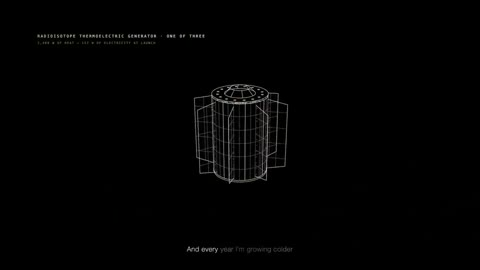

[← Back to gallery](../browse/music.en.md) · [简体中文](2104231930120249410.md)

# Voyager 1 in Coded Musical Imagery

**[thoughtcrime · @thoughtcrime\_\_\_](https://x.com/thoughtcrime___)** · Music & lyrics · 216s

> Discovery pool · Source verified; catalog details being completed.

**[▶ Open gallery to play](https://guanmo-ai.github.io/awesome-ai-motion/?lang=en#case-2104231930120249410)** · [Original post](https://x.com/thoughtcrime___/status/2104231930120249410)

Click the cover to open the gallery and play.

Flight data, cosmic graphics and music shape a Voyager 1 themed film.

No public prompt has been verified. [View the original post](https://x.com/thoughtcrime___/status/2104231930120249410)

Bookmarks — · Likes — · Views —

## Source record

- Original post: [@thoughtcrime\_\_\_](https://x.com/thoughtcrime___/status/2104231930120249410) · 2026-09-27T15:29:21+00:00
- Model attribution: Claude Opus 5.5 · [Creator’s statement](https://x.com/thoughtcrime___/status/2104231930120249410)
- Prompt lookup: [Creator post](https://x.com/thoughtcrime___/status/2104231930120249410) · 2026-11-02 09:52 UTC
- Cover source: [Original cover source](https://x.com/thoughtcrime___/status/2104231930120249410) · 43.23s
- Metrics snapshot: [Original X post](https://x.com/thoughtcrime___/status/2104231930120249410) · 2026-11-02 09:19 UTC
- Gallery video source: [Original post media record](https://x.com/thoughtcrime___/status/2104231930120249410) · 2026-11-02 09:52 UTC · Post/media correspondence and media response checked; external reference, no re-upload

Model attribution is based on creator statements. Prompts have not been independently rerun; sound and visuals have not received a uniform quality rating. Videos reference original post media, not our uploads; redistribution permission has not been verified.
