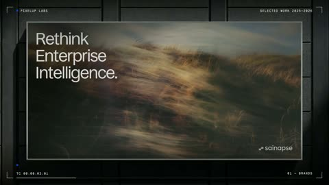

[← Back to gallery](../browse/product.en.md) · [简体中文](2104295133432922126.md)

# Pixel Up Labs Motion Showreel

**[Arjun Sharma · @arjunsh1607](https://x.com/arjunsh1607)** · Product & marketing · 15s

> Discovery pool · Source verified; catalog details being completed.

**[▶ Open gallery to play](https://guanmo-ai.github.io/awesome-ai-motion/?lang=en#case-2104295133432922126)** · [Original post](https://x.com/arjunsh1607/status/2104295133432922126)

Click the cover to open the gallery and play.

Screens, pages and brand typography form a showreel through layered transitions.

No public prompt has been verified. [View the original post](https://x.com/arjunsh1607/status/2104295133432922126)

Bookmarks — · Likes — · Views —

## Source record

- Original post: [@arjunsh1607](https://x.com/arjunsh1607/status/2104295133432922126) · 2026-09-27T19:40:30+00:00
- Model attribution: Claude Opus 5.5 · [Creator’s statement](https://x.com/arjunsh1607/status/2104295133432922126)
- Prompt lookup: [Creator post](https://x.com/arjunsh1607/status/2104295133432922126) · 2026-11-03 09:18 UTC
- Cover source: [Original cover source](https://x.com/arjunsh1607/status/2104295133432922126) · 3.01s
- Metrics snapshot: [Original X post](https://x.com/arjunsh1607/status/2104295133432922126) · 2026-11-03 08:38 UTC
- Gallery video source: [Original post media record](https://x.com/arjunsh1607/status/2104295133432922126) · 2026-11-03 09:18 UTC · Post/media correspondence and media response checked; external reference, no re-upload

Model attribution is based on creator statements. Prompts have not been independently rerun; sound and visuals have not received a uniform quality rating. Videos reference original post media, not our uploads; redistribution permission has not been verified.
