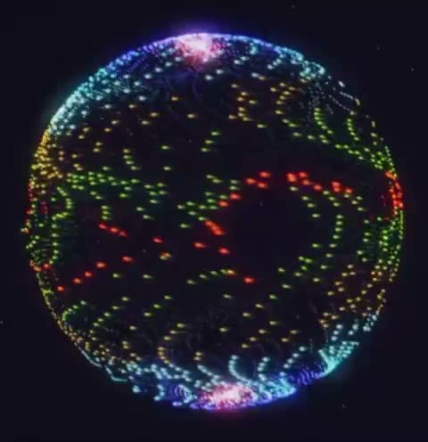

[← Back to gallery](../browse/music.en.md) · [简体中文](2104346758968975606.md)

# A Sphere of Colored Light

**[Tim · @prvctice\_com](https://x.com/prvctice_com)** · Music & lyrics · 32s

> Discovery pool · Source verified; catalog details being completed.

**[▶ Open gallery to play](https://guanmo-ai.github.io/awesome-ai-motion/?lang=en#case-2104346758968975606)** · [Original post](https://x.com/prvctice_com/status/2104346758968975606)

Click the cover to open the gallery and play.

Colored points form a sphere for a music visualization.

No public prompt has been verified. [View the original post](https://x.com/prvctice_com/status/2104346758968975606)

Bookmarks 0 · Likes 0 · Views 16

## Source record

- Original post: [@prvctice\_com](https://x.com/prvctice_com/status/2104346758968975606) · 2026-09-27T23:05:38+00:00
- Model attribution: Opus 5.5 · [Creator’s statement](https://x.com/prvctice_com/status/2104346758968975606)
- Prompt lookup: [Creator post](https://x.com/prvctice_com/status/2104346758968975606) · 2026-10-16 07:20 UTC
- Cover source: [Original cover source](https://x.com/prvctice_com/status/2104346758968975606) · 6.33s
- Metrics snapshot: [Original X post](https://x.com/prvctice_com/status/2104346758968975606) · 2026-10-16 07:20 UTC
- Gallery video source: [Original post media record](https://x.com/prvctice_com/status/2104346758968975606) · 2026-10-16 07:20 UTC · Post/media correspondence and media response checked; external reference, no re-upload

Model attribution is based on creator statements. Prompts have not been independently rerun; sound and visuals have not received a uniform quality rating. Videos reference original post media, not our uploads; redistribution permission has not been verified.
