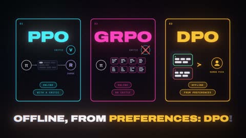

[← Back to gallery](../browse/education.en.md) · [简体中文](2104350237062021225.md)

# PPO, GRPO and DPO in Animated Graphics

**[Dongxi 东锡 NLP · @dongxi\_nlp](https://x.com/dongxi_nlp)** · Education & explainers · 155s

> Discovery pool · Source verified; catalog details being completed.

**[▶ Open gallery to play](https://guanmo-ai.github.io/awesome-ai-motion/?lang=en#case-2104350237062021225)** · [Original post](https://x.com/dongxi_nlp/status/2104350237062021225)

Click the cover to open the gallery and play.

Cards, bars and curves illustrate concepts around three training methods, documented for their visual treatment.

No public prompt has been verified. [View the original post](https://x.com/dongxi_nlp/status/2104350237062021225)

Bookmarks — · Likes — · Views —

## Source record

- Original post: [@dongxi\_nlp](https://x.com/dongxi_nlp/status/2104350237062021225) · 2026-09-27T23:19:28+00:00
- Model attribution: Claude Opus 5.5 · [Creator’s statement](https://x.com/dongxi_nlp/status/2104350237062021225)
- Prompt lookup: [Creator post](https://x.com/dongxi_nlp/status/2104350237062021225) · 2026-11-02 15:38 UTC
- Cover source: [Original cover source](https://x.com/dongxi_nlp/status/2104350237062021225) · 31.01s
- Metrics snapshot: [Original X post](https://x.com/dongxi_nlp/status/2104350237062021225) · 2026-11-02 15:08 UTC
- Gallery video source: [Original post media record](https://x.com/dongxi_nlp/status/2104350237062021225) · 2026-11-02 15:38 UTC · Post/media correspondence and media response checked; external reference, no re-upload

Model attribution is based on creator statements. Prompts have not been independently rerun; sound and visuals have not received a uniform quality rating. Videos reference original post media, not our uploads; redistribution permission has not been verified.
