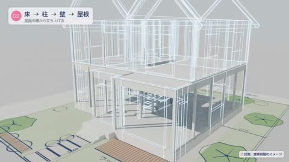

[← Back to gallery](../browse/interactive.en.md) · [简体中文](2104405050550521952.md)

# A House Assembles from Blueprint to Finish

**[アユネオ · @Ayu\_AI\_0912](https://x.com/Ayu_AI_0912)** · 3D & interactive · 24s

> Discovery pool · Source verified; catalog details being completed.

**[▶ Open gallery to play](https://guanmo-ai.github.io/awesome-ai-motion/?lang=en#case-2104405050550521952)** · [Original post](https://x.com/Ayu_AI_0912/status/2104405050550521952)

Click the cover to open the gallery and play.

Blueprints, building parts and the finished house transition through a staged construction sequence.

No public prompt has been verified. [View the original post](https://x.com/Ayu_AI_0912/status/2104405050550521952)

Bookmarks — · Likes — · Views —

## Source record

- Original post: [@Ayu\_AI\_0912](https://x.com/Ayu_AI_0912/status/2104405050550521952) · 2026-09-28T02:57:16+00:00
- Model attribution: Claude Opus 5.5 · [Creator’s statement](https://x.com/Ayu_AI_0912/status/2104405050550521952)
- Prompt lookup: [Creator post](https://x.com/Ayu_AI_0912/status/2104405050550521952) · 2026-11-02 09:52 UTC
- Cover source: [Original cover source](https://x.com/Ayu_AI_0912/status/2104405050550521952) · 4.71s
- Metrics snapshot: [Original X post](https://x.com/Ayu_AI_0912/status/2104405050550521952) · 2026-11-02 09:18 UTC
- Gallery video source: [Original post media record](https://x.com/Ayu_AI_0912/status/2104405050550521952) · 2026-11-02 09:52 UTC · Post/media correspondence and media response checked; external reference, no re-upload

Model attribution is based on creator statements. Prompts have not been independently rerun; sound and visuals have not received a uniform quality rating. Videos reference original post media, not our uploads; redistribution permission has not been verified.
