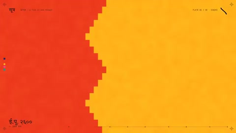

[← Back to gallery](../browse/education.en.md) · [简体中文](2104451249269780900.md)

# A Graphic Chronicle of Indian Civilization

**[Build Fast with AI · @BuildFastWithAI](https://x.com/BuildFastWithAI)** · Education & explainers · 87s

> Discovery pool · Source verified; catalog details being completed.

**[▶ Open gallery to play](https://guanmo-ai.github.io/awesome-ai-motion/?lang=en#case-2104451249269780900)** · [Original post](https://x.com/BuildFastWithAI/status/2104451249269780900)

Click the cover to open the gallery and play.

Maps, geometric patterns, typography and a timeline change by chapter in an animated account of Indian civilization.

The creator has shared instructions; this catalog links to the source without redistributing the full text or translation. [Read the creator’s original](https://x.com/BuildFastWithAI/status/2104451249269780900)

Bookmarks 0 · Likes 3 · Views 446

## Source record

- Original post: [@BuildFastWithAI](https://x.com/BuildFastWithAI/status/2104451249269780900) · 2026-09-28T06:00:51+00:00
- Model attribution: Claude Opus 5.5 · [Creator’s statement](https://x.com/BuildFastWithAI/status/2104451249269780900)
- Prompt source: [Creator post](https://x.com/BuildFastWithAI/status/2104451249269780900) · 2026-10-23 05:30 UTC
- Cover source: [Original cover source](https://x.com/BuildFastWithAI/status/2104451249269780900) · 17.4s
- Metrics snapshot: [Original X post](https://x.com/BuildFastWithAI/status/2104451249269780900) · 2026-10-23 05:30 UTC
- Gallery video source: [Original post media record](https://x.com/BuildFastWithAI/status/2104451249269780900) · 2026-10-23 05:30 UTC · Post/media correspondence and media response checked; external reference, no re-upload

Model attribution is based on creator statements. Prompts have not been independently rerun; sound and visuals have not received a uniform quality rating. Videos reference original post media, not our uploads; redistribution permission has not been verified.
