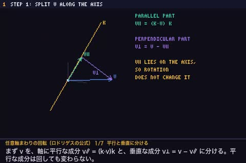

[← Back to gallery](../browse/education.en.md) · [简体中文](2104500154447593733.md)

# An Animated Arbitrary-Axis Rotation Matrix

**[shi3z · @shi3z](https://x.com/shi3z)** · Education & explainers · 73s

> Discovery pool · Source verified; catalog details being completed.

**[▶ Open gallery to play](https://guanmo-ai.github.io/awesome-ai-motion/?lang=en#case-2104500154447593733)** · [Original post](https://x.com/shi3z/status/2104500154447593733)

Click the cover to open the gallery and play.

Axes, a rotating object and matrix expressions move together to explain arbitrary-axis rotation.

No public prompt has been verified. [View the original post](https://x.com/shi3z/status/2104500154447593733)

Bookmarks — · Likes — · Views —

## Source record

- Original post: [@shi3z](https://x.com/shi3z/status/2104500154447593733) · 2026-09-28T09:15:11+00:00
- Model attribution: Claude Opus 5.5 · [Creator’s statement](https://x.com/shi3z/status/2104500154447593733)
- Prompt lookup: [Creator post](https://x.com/shi3z/status/2104500154447593733) · 2026-11-02 09:52 UTC
- Cover source: [Original cover source](https://x.com/shi3z/status/2104500154447593733) · 14.56s
- Metrics snapshot: [Original X post](https://x.com/shi3z/status/2104500154447593733) · 2026-11-02 09:18 UTC
- Gallery video source: [Original post media record](https://x.com/shi3z/status/2104500154447593733) · 2026-11-02 09:52 UTC · Post/media correspondence and media response checked; external reference, no re-upload

Model attribution is based on creator statements. Prompts have not been independently rerun; sound and visuals have not received a uniform quality rating. Videos reference original post media, not our uploads; redistribution permission has not been verified.
