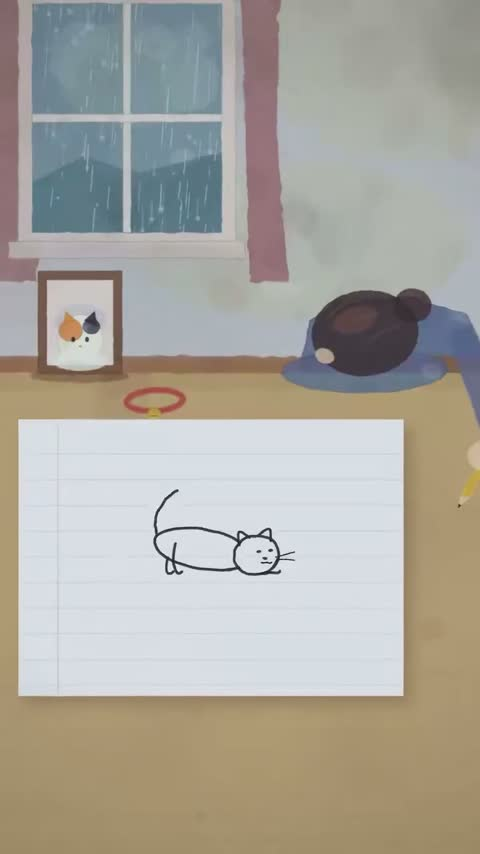

[← Back to gallery](../browse/characters.en.md) · [简体中文](2104516257672483187.md)

# A Paper-Like Cat by the Window

**[七深麗音(ななみレオ) シンガー＆マルチクリエイター · @nanami\_leo4](https://x.com/nanami_leo4)** · Pixel art & characters · 31s

> Discovery pool · Source verified; catalog details being completed.

**[▶ Open gallery to play](https://guanmo-ai.github.io/awesome-ai-motion/?lang=en#case-2104516257672483187)** · [Original post](https://x.com/nanami_leo4/status/2104516257672483187)

Click the cover to open the gallery and play.

A flat cat and a window-side scene form a short everyday animation through small movements.

No public prompt has been verified. [View the original post](https://x.com/nanami_leo4/status/2104516257672483187)

Bookmarks — · Likes — · Views —

## Source record

- Original post: [@nanami\_leo4](https://x.com/nanami_leo4/status/2104516257672483187) · 2026-09-28T10:19:10+00:00
- Model attribution: Claude Opus 5.5 · [Creator’s statement](https://x.com/nanami_leo4/status/2104516257672483187)
- Prompt lookup: [Creator post](https://x.com/nanami_leo4/status/2104516257672483187) · 2026-11-02 09:52 UTC
- Cover source: [Original cover source](https://x.com/nanami_leo4/status/2104516257672483187) · 6.21s
- Metrics snapshot: [Original X post](https://x.com/nanami_leo4/status/2104516257672483187) · 2026-11-02 09:18 UTC
- Gallery video source: [Original post media record](https://x.com/nanami_leo4/status/2104516257672483187) · 2026-11-02 09:52 UTC · Post/media correspondence and media response checked; external reference, no re-upload

Model attribution is based on creator statements. Prompts have not been independently rerun; sound and visuals have not received a uniform quality rating. Videos reference original post media, not our uploads; redistribution permission has not been verified.
