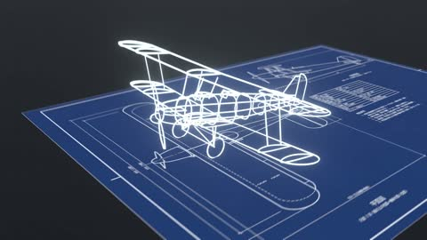

[← Back to gallery](../browse/interactive.en.md) · [简体中文](2104549952987041925.md)

# A Biplane Assembles for a Cat's Takeoff

**[Shoji Kai · @Shoji\_ai](https://x.com/Shoji_ai)** · 3D & interactive · 26s

> Discovery pool · Source verified; catalog details being completed.

**[▶ Open gallery to play](https://guanmo-ai.github.io/awesome-ai-motion/?lang=en#case-2104549952987041925)** · [Original post](https://x.com/Shoji_ai/status/2104549952987041925)

Click the cover to open the gallery and play.

A plane assembles from blueprints before a cat character pilots its takeoff.

No public prompt has been verified. [View the original post](https://x.com/Shoji_ai/status/2104549952987041925)

Bookmarks — · Likes — · Views —

## Source record

- Original post: [@Shoji\_ai](https://x.com/Shoji_ai/status/2104549952987041925) · 2026-09-28T12:33:04+00:00
- Model attribution: Claude Opus 5.5 · [Creator’s statement](https://x.com/Shoji_ai/status/2104549952987041925)
- Prompt lookup: [Creator post](https://x.com/Shoji_ai/status/2104549952987041925) · 2026-11-02 09:52 UTC
- Cover source: [Original cover source](https://x.com/Shoji_ai/status/2104549952987041925) · 5.16s
- Metrics snapshot: [Original X post](https://x.com/Shoji_ai/status/2104549952987041925) · 2026-11-02 09:18 UTC
- Gallery video source: [Original post media record](https://x.com/Shoji_ai/status/2104549952987041925) · 2026-11-02 09:52 UTC · Post/media correspondence and media response checked; external reference, no re-upload

Model attribution is based on creator statements. Prompts have not been independently rerun; sound and visuals have not received a uniform quality rating. Videos reference original post media, not our uploads; redistribution permission has not been verified.
