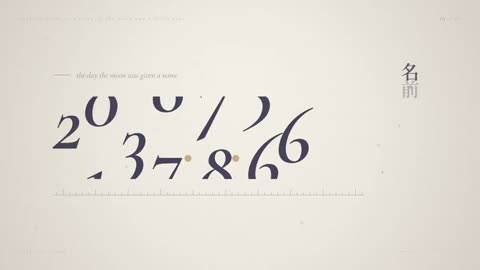

[← Back to gallery](../browse/motion.en.md) · [简体中文](2104554735382778328.md)

# Memories in Numbers and Rings

**[もにゃ · @monya\_for\_io](https://x.com/monya_for_io)** · Motion design · 28s

> Discovery pool · Source verified; catalog details being completed.

**[▶ Open gallery to play](https://guanmo-ai.github.io/awesome-ai-motion/?lang=en#case-2104554735382778328)** · [Original post](https://x.com/monya_for_io/status/2104554735382778328)

Click the cover to open the gallery and play.

Numbers, rings and type shift in scale and position around a memory theme.

No public prompt has been verified. [View the original post](https://x.com/monya_for_io/status/2104554735382778328)

Bookmarks — · Likes — · Views —

## Source record

- Original post: [@monya\_for\_io](https://x.com/monya_for_io/status/2104554735382778328) · 2026-09-28T12:52:04+00:00
- Model attribution: Claude Opus 5.5 · [Creator’s statement](https://x.com/monya_for_io/status/2104554735382778328)
- Prompt lookup: [Creator post](https://x.com/monya_for_io/status/2104554735382778328) · 2026-11-02 09:52 UTC
- Cover source: [Original cover source](https://x.com/monya_for_io/status/2104554735382778328) · 5.6s
- Metrics snapshot: [Original X post](https://x.com/monya_for_io/status/2104554735382778328) · 2026-11-02 09:18 UTC
- Gallery video source: [Original post media record](https://x.com/monya_for_io/status/2104554735382778328) · 2026-11-02 09:52 UTC · Post/media correspondence and media response checked; external reference, no re-upload

Model attribution is based on creator statements. Prompts have not been independently rerun; sound and visuals have not received a uniform quality rating. Videos reference original post media, not our uploads; redistribution permission has not been verified.
