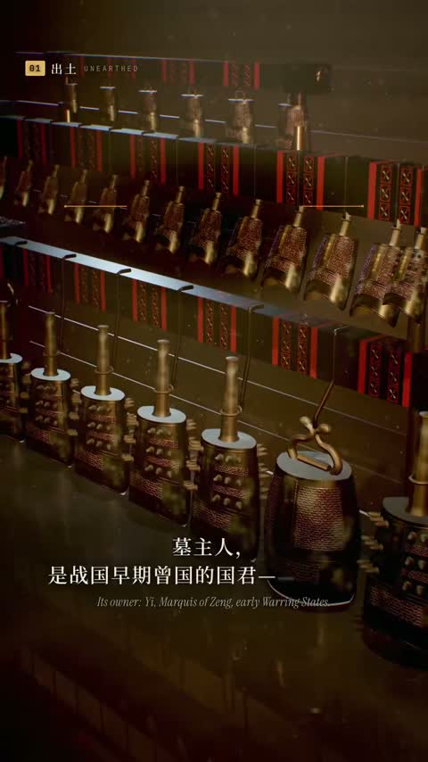

[← Back to gallery](../browse/education.en.md) · [简体中文](2104560246299783172.md)

# An Animated Explainer of the Zenghouyi Bells

**[Andy L · @AndyL5cc](https://x.com/AndyL5cc)** · Education & explainers · 139s

> Discovery pool · Source verified; catalog details being completed.

**[▶ Open gallery to play](https://guanmo-ai.github.io/awesome-ai-motion/?lang=en#case-2104560246299783172)** · [Original post](https://x.com/AndyL5cc/status/2104560246299783172)

Click the cover to open the gallery and play.

Bell structures, artifacts and type unfold through camera moves in a historical-object explainer.

No public prompt has been verified. [View the original post](https://x.com/AndyL5cc/status/2104560246299783172)

Bookmarks — · Likes — · Views —

## Source record

- Original post: [@AndyL5cc](https://x.com/AndyL5cc/status/2104560246299783172) · 2026-09-28T13:13:58+00:00
- Model attribution: Claude Opus 5.5 · [Creator’s statement](https://x.com/AndyL5cc/status/2104560246299783172)
- Prompt lookup: [Creator post](https://x.com/AndyL5cc/status/2104560246299783172) · 2026-11-02 09:52 UTC
- Cover source: [Original cover source](https://x.com/AndyL5cc/status/2104560246299783172) · 27.87s
- Metrics snapshot: [Original X post](https://x.com/AndyL5cc/status/2104560246299783172) · 2026-11-02 09:18 UTC
- Gallery video source: [Original post media record](https://x.com/AndyL5cc/status/2104560246299783172) · 2026-11-02 09:52 UTC · Post/media correspondence and media response checked; external reference, no re-upload

Model attribution is based on creator statements. Prompts have not been independently rerun; sound and visuals have not received a uniform quality rating. Videos reference original post media, not our uploads; redistribution permission has not been verified.
