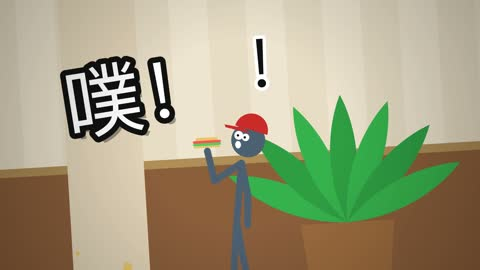

[← Back to gallery](../browse/characters.en.md) · [简体中文](2104569773598401021.md)

# A Flash-Style Stick-Figure Interface Battle

**[Gorden Sun · @Gorden\_Sun](https://x.com/Gorden_Sun)** · Pixel art & characters · 172s

> Discovery pool · Source verified; catalog details being completed.

**[▶ Open gallery to play](https://guanmo-ai.github.io/awesome-ai-motion/?lang=en#case-2104569773598401021)** · [Original post](https://x.com/Gorden_Sun/status/2104569773598401021)

Click the cover to open the gallery and play.

Stick figures cross interfaces and stages in a battle of exaggerated movement, impacts and graphic sound effects.

No public prompt has been verified. [View the original post](https://x.com/Gorden_Sun/status/2104569773598401021)

Bookmarks — · Likes — · Views —

## Source record

- Original post: [@Gorden\_Sun](https://x.com/Gorden_Sun/status/2104569773598401021) · 2026-09-28T13:51:49+00:00
- Model attribution: Claude Opus 5.5 · [Creator’s statement](https://x.com/Gorden_Sun/status/2104569773598401021)
- Prompt lookup: [Creator post](https://x.com/Gorden_Sun/status/2104569773598401021) · 2026-11-02 09:52 UTC
- Cover source: [Original cover source](https://x.com/Gorden_Sun/status/2104569773598401021) · 34.34s
- Metrics snapshot: [Original X post](https://x.com/Gorden_Sun/status/2104569773598401021) · 2026-11-02 09:18 UTC
- Gallery video source: [Original post media record](https://x.com/Gorden_Sun/status/2104569773598401021) · 2026-11-02 09:52 UTC · Post/media correspondence and media response checked; external reference, no re-upload

Model attribution is based on creator statements. Prompts have not been independently rerun; sound and visuals have not received a uniform quality rating. Videos reference original post media, not our uploads; redistribution permission has not been verified.
