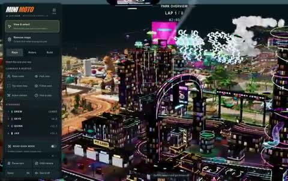

[← Back to gallery](../browse/interactive.en.md) · [简体中文](2104598205417591120.md)

# A Miniature City Motorcycle Park

**[Christopher J. DiMarco · @chrisjdimarco](https://x.com/chrisjdimarco)** · 3D & interactive · 100s

> Discovery pool · Source verified; catalog details being completed.

**[▶ Open gallery to play](https://guanmo-ai.github.io/awesome-ai-motion/?lang=en#case-2104598205417591120)** · [Original post](https://x.com/chrisjdimarco/status/2104598205417591120)

Click the cover to open the gallery and play.

Neon streets, roller-coaster roads and miniature buildings create a riding scene with changing heights and camera angles.

No public prompt has been verified. [View the original post](https://x.com/chrisjdimarco/status/2104598205417591120)

Bookmarks 1,153 · Likes 1,779 · Views 102,252

## Source record

- Original post: [@chrisjdimarco](https://x.com/chrisjdimarco/status/2104598205417591120) · 2026-09-28T15:44:48+00:00
- Model attribution: Claude Opus 5.5 · [Creator’s statement](https://x.com/chrisjdimarco/status/2104598205417591120)
- Prompt lookup: [Creator post](https://x.com/chrisjdimarco/status/2104598205417591120) · 2026-10-23 05:30 UTC
- Cover source: [Original cover source](https://x.com/chrisjdimarco/status/2104598205417591120) · 20.08s
- Metrics snapshot: [Original X post](https://x.com/chrisjdimarco/status/2104598205417591120) · 2026-10-23 05:30 UTC
- Gallery video source: [Original post media record](https://x.com/chrisjdimarco/status/2104598205417591120) · 2026-10-23 05:30 UTC · Post/media correspondence and media response checked; external reference, no re-upload

Model attribution is based on creator statements. Prompts have not been independently rerun; sound and visuals have not received a uniform quality rating. Videos reference original post media, not our uploads; redistribution permission has not been verified.
