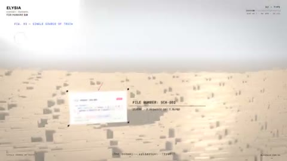

[← Back to gallery](../browse/product.en.md) · [简体中文](2104677989728620933.md)

# Elysia: Code Fragments Become Paper Planes

**[SaltyAom · @saltyAom](https://x.com/saltyAom)** · Product & marketing · 94s

> Discovery pool · Source verified; catalog details being completed.

**[▶ Open gallery to play](https://guanmo-ai.github.io/awesome-ai-motion/?lang=en#case-2104677989728620933)** · [Original post](https://x.com/saltyAom/status/2104677989728620933)

Click the cover to open the gallery and play.

Code cards, paper planes and short headlines assemble and scatter in a light space, rendered frame by frame with WebGL.

No public prompt has been verified. [View the original post](https://x.com/saltyAom/status/2104677989728620933)

Bookmarks 121 · Likes 445 · Views 11,332

## Source record

- Original post: [@saltyAom](https://x.com/saltyAom/status/2104677989728620933) · 2026-09-28T21:01:50+00:00
- Model attribution: Claude Opus 5.5 · [Creator’s statement](https://x.com/saltyAom/status/2104677989728620933)
- Prompt lookup: [Creator post](https://x.com/saltyAom/status/2104677989728620933) · 2026-10-23 05:30 UTC
- Cover source: [Original cover source](https://x.com/saltyAom/status/2104677989728620933) · 18.87s
- Metrics snapshot: [Original X post](https://x.com/saltyAom/status/2104677989728620933) · 2026-10-23 05:30 UTC
- Gallery video source: [Original post media record](https://x.com/saltyAom/status/2104677989728620933) · 2026-10-23 05:30 UTC · Post/media correspondence and media response checked; external reference, no re-upload

Model attribution is based on creator statements. Prompts have not been independently rerun; sound and visuals have not received a uniform quality rating. Videos reference original post media, not our uploads; redistribution permission has not been verified.
