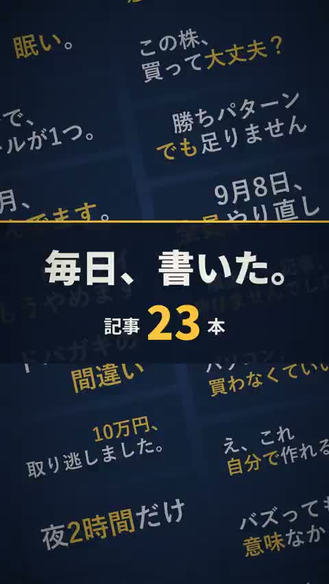

[← Back to gallery](../browse/product.en.md) · [简体中文](2104771218503352649.md)

# An Animated Resume from X Activity

**[レム⚛️Cosmos🥷 · @lemcosmos](https://x.com/lemcosmos)** · Product & marketing · 15s

> Discovery pool · Source verified; catalog details being completed.

**[▶ Open gallery to play](https://guanmo-ai.github.io/awesome-ai-motion/?lang=en#case-2104771218503352649)** · [Original post](https://x.com/lemcosmos/status/2104771218503352649)

Click the cover to open the gallery and play.

Vertical typography, post cards and circular counters connect personal posting history and milestones.

The creator has shared instructions; this catalog links to the source without redistributing the full text or translation. [Read the creator’s original](https://x.com/lemcosmos/status/2104771222005535145)

Bookmarks 2 · Likes 7 · Views 682

## Source record

- Original post: [@lemcosmos](https://x.com/lemcosmos/status/2104771218503352649) · 2026-09-29T03:12:17+00:00
- Model attribution: Claude Opus 5.5 · [Creator’s statement](https://x.com/lemcosmos/status/2104771218503352649)
- Prompt source: [Creator post](https://x.com/lemcosmos/status/2104771222005535145) · 2026-10-24 12:20 UTC
- Cover source: [Original cover source](https://x.com/lemcosmos/status/2104771218503352649) · 3s
- Metrics snapshot: [Original X post](https://x.com/lemcosmos/status/2104771218503352649) · 2026-10-24 12:20 UTC
- Gallery video source: [Original post media record](https://x.com/lemcosmos/status/2104771218503352649) · 2026-10-24 12:20 UTC · Post/media correspondence and media response checked; external reference, no re-upload

Model attribution is based on creator statements. Prompts have not been independently rerun; sound and visuals have not received a uniform quality rating. Videos reference original post media, not our uploads; redistribution permission has not been verified.
