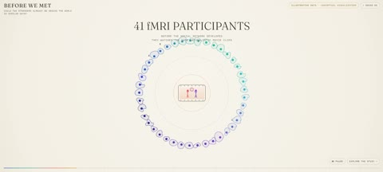

[← Back to gallery](../browse/education.en.md) · [简体中文](2104801713840590917.md)

# Brain Responses and Friendship Explainer

**[Dev Khanna · @CurieuxExplorer](https://x.com/CurieuxExplorer)** · Education & explainers · 61s

> Discovery pool · Source verified; catalog details being completed.

**[▶ Open gallery to play](https://guanmo-ai.github.io/awesome-ai-motion/?lang=en#case-2104801713840590917)** · [Original post](https://x.com/CurieuxExplorer/status/2104801713840590917)

Click the cover to open the gallery and play.

Dots, connections and animated groups explain research on brain responses and friendship.

No public prompt has been verified. [View the original post](https://x.com/CurieuxExplorer/status/2104801713840590917)

Bookmarks — · Likes — · Views —

## Source record

- Original post: [@CurieuxExplorer](https://x.com/CurieuxExplorer/status/2104801713840590917) · 2026-09-29T05:13:28+00:00
- Model attribution: Claude Opus 5.5 · [Creator’s statement](https://x.com/CurieuxExplorer/status/2104801713840590917)
- Prompt lookup: [Creator post](https://x.com/CurieuxExplorer/status/2104801713840590917) · 2026-11-03 09:18 UTC
- Cover source: [Original cover source](https://x.com/CurieuxExplorer/status/2104801713840590917) · 12.1s
- Metrics snapshot: [Original X post](https://x.com/CurieuxExplorer/status/2104801713840590917) · 2026-11-03 08:38 UTC
- Gallery video source: [Original post media record](https://x.com/CurieuxExplorer/status/2104801713840590917) · 2026-11-03 09:18 UTC · Post/media correspondence and media response checked; external reference, no re-upload

Model attribution is based on creator statements. Prompts have not been independently rerun; sound and visuals have not received a uniform quality rating. Videos reference original post media, not our uploads; redistribution permission has not been verified.
