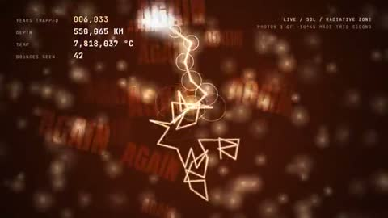

[← Back to gallery](../browse/education.en.md) · [简体中文](2104818940467945542.md)

# A Single Photon's Journey from Sun to Earth

**[Apoorv Jain · @apoorvjain25](https://x.com/apoorvjain25)** · Education & explainers · 20s

> Discovery pool · Source verified; catalog details being completed.

**[▶ Open gallery to play](https://guanmo-ai.github.io/awesome-ai-motion/?lang=en#case-2104818940467945542)** · [Original post](https://x.com/apoorvjain25/status/2104818940467945542)

Click the cover to open the gallery and play.

A light point bounces inside the Sun before traveling toward Earth, with Remotion animation and synthesized sound sharing motion data according to the creator.

No public prompt has been verified. [View the original post](https://x.com/apoorvjain25/status/2104818940467945542)

Bookmarks 0 · Likes 2 · Views 84

## Source record

- Original post: [@apoorvjain25](https://x.com/apoorvjain25/status/2104818940467945542) · 2026-09-29T06:21:55+00:00
- Model attribution: Claude Opus 5.5 · [Creator’s statement](https://x.com/apoorvjain25/status/2104818940467945542)
- Prompt lookup: [Creator post](https://x.com/apoorvjain25/status/2104818940467945542) · 2026-10-22 08:51 UTC
- Cover source: [Original cover source](https://x.com/apoorvjain25/status/2104818940467945542) · 4.01s
- Metrics snapshot: [Original X post](https://x.com/apoorvjain25/status/2104818940467945542) · 2026-10-22 08:51 UTC
- Gallery video source: [Original post media record](https://x.com/apoorvjain25/status/2104818940467945542) · 2026-10-22 08:51 UTC · Post/media correspondence and media response checked; external reference, no re-upload

Model attribution is based on creator statements. Prompts have not been independently rerun; sound and visuals have not received a uniform quality rating. Videos reference original post media, not our uploads; redistribution permission has not been verified.
