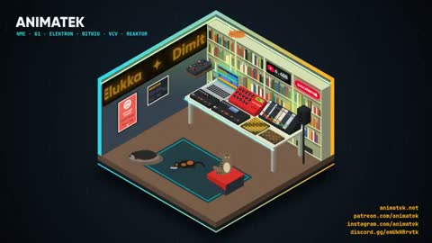

[← Back to gallery](../browse/music.en.md) · [简体中文](2104964729018151105.md)

# An Isometric Music Studio

**[animatek · @animatek](https://x.com/animatek)** · Music & lyrics · 160s

> Discovery pool · Source verified; catalog details being completed.

**[▶ Open gallery to play](https://guanmo-ai.github.io/awesome-ai-motion/?lang=en#case-2104964729018151105)** · [Original post](https://x.com/animatek/status/2104964729018151105)

Click the cover to open the gallery and play.

An isometric studio and animated equipment form a streaming intro.

No public prompt has been verified. [View the original post](https://x.com/animatek/status/2104964729018151105)

Bookmarks 0 · Likes 3 · Views 119

## Source record

- Original post: [@animatek](https://x.com/animatek/status/2104964729018151105) · 2026-09-29T16:01:14+00:00
- Model attribution: Opus 5.5 · [Creator’s statement](https://x.com/animatek/status/2104964729018151105)
- Prompt lookup: [Creator post](https://x.com/animatek/status/2104964729018151105) · 2026-10-16 07:20 UTC
- Cover source: [Original cover source](https://x.com/animatek/status/2104964729018151105) · 32s
- Metrics snapshot: [Original X post](https://x.com/animatek/status/2104964729018151105) · 2026-10-16 07:20 UTC
- Gallery video source: [Original post media record](https://x.com/animatek/status/2104964729018151105) · 2026-10-16 07:20 UTC · Post/media correspondence and media response checked; external reference, no re-upload

Model attribution is based on creator statements. Prompts have not been independently rerun; sound and visuals have not received a uniform quality rating. Videos reference original post media, not our uploads; redistribution permission has not been verified.
