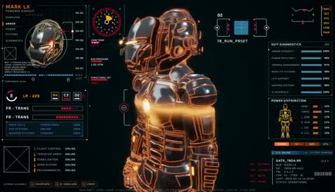

[← Back to gallery](../browse/interactive.en.md) · [简体中文](2104977431098757317.md)

# An Iron Armor Parts Interface

**[Dilum Sanjaya · @DilumSanjaya](https://x.com/DilumSanjaya)** · 3D & interactive · 49s

> Discovery pool · Source verified; catalog details being completed.

**[▶ Open gallery to play](https://guanmo-ai.github.io/awesome-ai-motion/?lang=en#case-2104977431098757317)** · [Original post](https://x.com/DilumSanjaya/status/2104977431098757317)

Click the cover to open the gallery and play.

Mechanical armor and exploded parts animate with an interface; the creator says its 920 parts were built in code.

No public prompt has been verified. [View the original post](https://x.com/DilumSanjaya/status/2104977431098757317)

Bookmarks 129 · Likes 308 · Views 22,408

## Source record

- Original post: [@DilumSanjaya](https://x.com/DilumSanjaya/status/2104977431098757317) · 2026-09-29T16:51:42+00:00
- Model attribution: Opus 5.5 · [Creator’s statement](https://x.com/DilumSanjaya/status/2104977431098757317)
- Prompt lookup: [Creator post](https://x.com/DilumSanjaya/status/2104977431098757317) · 2026-10-19 09:12 UTC
- Cover source: [Original cover source](https://x.com/DilumSanjaya/status/2104977431098757317) · 9.75s
- Metrics snapshot: [Original X post](https://x.com/DilumSanjaya/status/2104977431098757317) · 2026-10-19 09:12 UTC
- Gallery video source: [Original post media record](https://x.com/DilumSanjaya/status/2104977431098757317) · 2026-10-19 09:12 UTC · Post/media correspondence and media response checked; external reference, no re-upload

Model attribution is based on creator statements. Prompts have not been independently rerun; sound and visuals have not received a uniform quality rating. Videos reference original post media, not our uploads; redistribution permission has not been verified.
