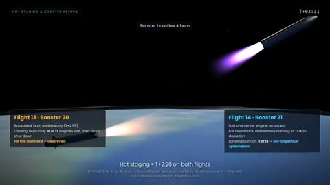

[← Back to gallery](../browse/education.en.md) · [简体中文](2105012737218617555.md)

# A Parallel 3D Explainer of Two Starship Flights

**[Cruz · @ViC305](https://x.com/ViC305)** · Education & explainers · 161s

> Discovery pool · Source verified; catalog details being completed.

**[▶ Open gallery to play](https://guanmo-ai.github.io/awesome-ai-motion/?lang=en#case-2105012737218617555)** · [Original post](https://x.com/ViC305/status/2105012737218617555)

Click the cover to open the gallery and play.

Ships, Earth and flight phases unfold in parallel panels, with paths, clocks and labels comparing two launches in creator-reported code-built scenes.

The creator has shared instructions; this catalog links to the source without redistributing the full text or translation. [Read the creator’s original](https://x.com/ViC305/status/2105012738174885957)

Bookmarks 1 · Likes 14 · Views 1,010

## Source record

- Original post: [@ViC305](https://x.com/ViC305/status/2105012737218617555) · 2026-09-29T19:12:00+00:00
- Model attribution: Claude Opus 5.5 · [Creator’s statement](https://x.com/ViC305/status/2105012737218617555)
- Prompt source: [Creator post](https://x.com/ViC305/status/2105012738174885957) · 2026-10-23 05:30 UTC
- Cover source: [Original cover source](https://x.com/ViC305/status/2105012737218617555) · 32.2s
- Metrics snapshot: [Original X post](https://x.com/ViC305/status/2105012737218617555) · 2026-10-23 05:30 UTC
- Gallery video source: [Original post media record](https://x.com/ViC305/status/2105012737218617555) · 2026-10-23 05:30 UTC · Post/media correspondence and media response checked; external reference, no re-upload

Model attribution is based on creator statements. Prompts have not been independently rerun; sound and visuals have not received a uniform quality rating. Videos reference original post media, not our uploads; redistribution permission has not been verified.
