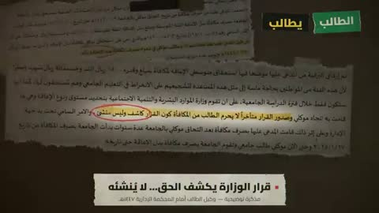

[← 返回图库](../browse/education.md) · [English](2105177788043157811.en.md)

# 阿拉伯文档的剪贴讲解

**[x7md \| hmd.sa · @X7mdNet](https://x.com/X7mdNet)** · 知识讲解 · 91s

> 发现池 · 来源已核对，编目资料待完善。

**[▶ 打开画廊播放](https://guanmo-ai.github.io/awesome-ai-motion/#case-2105177788043157811)** · [作者原帖](https://x.com/X7mdNet/status/2105177788043157811)

点击封面打开画廊播放。

撕纸边缘、文档摘录与文字高亮交替组合，以剪贴式图形组织说明。

未取得作者公开提示词。 [查看作者原帖](https://x.com/X7mdNet/status/2105177788043157811)

收藏 70 · 点赞 44 · 浏览 5,791

## 来源记录

- 作品原帖: [@X7mdNet](https://x.com/X7mdNet/status/2105177788043157811) · 2026-09-30T06:07:51+00:00
- 模型归因: Claude Opus 5.5 · [作者说明](https://x.com/X7mdNet/status/2105177788043157811)
- 提示词查阅记录: [作者原帖](https://x.com/X7mdNet/status/2105177788043157811) · 2026-10-24 12:20 UTC
- 封面来源: [原帖封面来源](https://x.com/X7mdNet/status/2105177788043157811) · 18.25s
- 互动快照: [X 原帖](https://x.com/X7mdNet/status/2105177788043157811) · 2026-10-24 12:20 UTC
- 画廊原视频: [原帖媒体记录](https://x.com/X7mdNet/status/2105177788043157811) · 2026-10-24 12:20 UTC · 已核对原帖媒体对应与媒体响应；外部引用，不重新上传

模型依据来自作者自述，未独立重跑提示词，也未对音画作统一质量评级。视频引用作者原帖媒体，未由本站重新上传，转载许可未确认。
