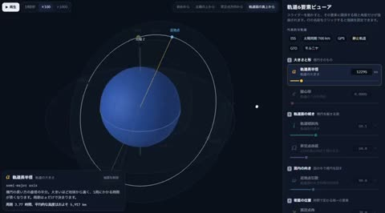

[← Back to gallery](../browse/education.en.md) · [简体中文](2105200070446751750.md)

# Six Orbital Elements Explained in Interactive 3D

**[getBack1969 · @getBack\_1969\_](https://x.com/getBack_1969_)** · Education & explainers · 60s

> Discovery pool · Source verified; catalog details being completed.

**[▶ Open gallery to play](https://guanmo-ai.github.io/awesome-ai-motion/?lang=en#case-2105200070446751750)** · [Original post](https://x.com/getBack_1969_/status/2105200070446751750)

Click the cover to open the gallery and play.

[The creator's interactive scene](https://ki-math.github.io/orbital-elements-viewer/) · [Orbital elements project source](https://github.com/Ki-math/orbital-elements-viewer)

A globe, orbital ellipse and angle markers move together as parameters change in an interactive explanation with a linked demo.

## Source & web pages

- **Public web page**：[The creator's interactive scene](https://ki-math.github.io/orbital-elements-viewer/)
  [Link source](https://x.com/getBack_1969_/status/2105200070446751750) · Link checked 2026-10-22 10:25 UTC
- **Direct source**：[Orbital elements project source](https://github.com/Ki-math/orbital-elements-viewer) · No license specified
  The README links the same demo and lists its scene and orbital-calculation files. No overall license was found.
  [Link source](https://ki-math.github.io/orbital-elements-viewer/) · Link checked 2026-10-22 10:31 UTC

No public prompt has been verified. [View the original post](https://x.com/getBack_1969_/status/2105200070446751750)

Bookmarks 526 · Likes 701 · Views 84,801

## Source record

- Original post: [@getBack\_1969\_](https://x.com/getBack_1969_/status/2105200070446751750) · 2026-09-30T07:36:24+00:00
- Model attribution: Claude Opus 5.5 · [Creator’s statement](https://x.com/getBack_1969_/status/2105200070446751750)
- Prompt lookup: [Creator post](https://x.com/getBack_1969_/status/2105200070446751750) · 2026-10-22 10:31 UTC
- Cover source: [Original cover source](https://x.com/getBack_1969_/status/2105200070446751750) · 12.05s
- Metrics snapshot: [Original X post](https://x.com/getBack_1969_/status/2105200070446751750) · 2026-10-22 10:31 UTC
- Gallery video source: [Original post media record](https://x.com/getBack_1969_/status/2105200070446751750) · 2026-10-22 10:31 UTC · Post/media correspondence and media response checked; external reference, no re-upload

Model attribution is based on creator statements. Prompts have not been independently rerun; sound and visuals have not received a uniform quality rating. Videos reference original post media, not our uploads; redistribution permission has not been verified.
