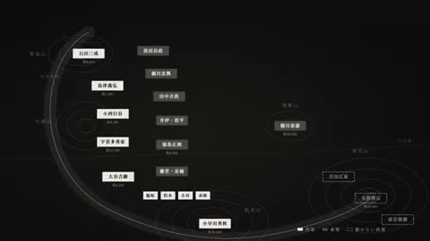

[← Back to gallery](../browse/education.en.md) · [简体中文](2105271839698428235.md)

# Sekigahara: The Battle Map Turns

**[たくぞー｜AI動画ツール実測レビュー · @tkz\_aiart](https://x.com/tkz_aiart)** · Education & explainers · 135s

> Discovery pool · Source verified; catalog details being completed.

**[▶ Open gallery to play](https://guanmo-ai.github.io/awesome-ai-motion/?lang=en#case-2105271839698428235)** · [Original post](https://x.com/tkz_aiart/status/2105271839698428235)

Click the cover to open the gallery and play.

Troop markers, routes and changing map colors narrate a battle.

No public prompt has been verified. [View the original post](https://x.com/tkz_aiart/status/2105271839698428235)

Bookmarks 181 · Likes 146 · Views 32,653

## Source record

- Original post: [@tkz\_aiart](https://x.com/tkz_aiart/status/2105271839698428235) · 2026-09-30T12:21:35+00:00
- Model attribution: Opus 5.5 · [Creator’s statement](https://x.com/tkz_aiart/status/2105271839698428235)
- Prompt lookup: [Creator post](https://x.com/tkz_aiart/status/2105271839698428235) · 2026-10-16 07:01 UTC
- Cover source: [Original cover source](https://x.com/tkz_aiart/status/2105271839698428235) · 27s
- Metrics snapshot: [Original X post](https://x.com/tkz_aiart/status/2105271839698428235) · 2026-10-16 07:01 UTC
- Gallery video source: [Original post media record](https://x.com/tkz_aiart/status/2105271839698428235) · 2026-10-16 07:01 UTC · Post/media correspondence and media response checked; external reference, no re-upload

Model attribution is based on creator statements. Prompts have not been independently rerun; sound and visuals have not received a uniform quality rating. Videos reference original post media, not our uploads; redistribution permission has not been verified.
