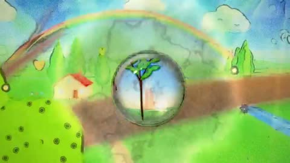

[← Back to gallery](../browse/stories.en.md) · [简体中文](2105302834551935055.md)

# Water Has Memory: A Multi-Style Animation Experiment

**[Ishu Agrawal · @ishuagra02](https://x.com/ishuagra02)** · Narrative films · 128s

> Discovery pool · Source verified; catalog details being completed.

**[▶ Open gallery to play](https://guanmo-ai.github.io/awesome-ai-motion/?lang=en#case-2105302834551935055)** · [Original post](https://x.com/ishuagra02/status/2105302834551935055)

Click the cover to open the gallery and play.

A drop and cartoon characters move through watercolor and pencil styles in an Opus 5.5 experiment based on the creator’s “water has memory” brief.

No public prompt has been verified. [View the original post](https://x.com/ishuagra02/status/2105302834551935055)

Bookmarks 4 · Likes 18 · Views 1,123

## Source record

- Original post: [@ishuagra02](https://x.com/ishuagra02/status/2105302834551935055) · 2026-09-30T14:24:45+00:00
- Model attribution: Claude Opus 5.5 · [Creator’s statement](https://x.com/ishuagra02/status/2105302834551935055)
- Prompt lookup: [Creator post](https://x.com/ishuagra02/status/2105302834551935055) · 2026-10-21 09:54 UTC
- Cover source: [Original cover source](https://x.com/ishuagra02/status/2105302834551935055) · 25.61s
- Metrics snapshot: [Original X post](https://x.com/ishuagra02/status/2105302834551935055) · 2026-10-21 09:54 UTC
- Gallery video source: [Original post media record](https://x.com/ishuagra02/status/2105302834551935055) · 2026-10-21 09:54 UTC · Post/media correspondence and media response checked; external reference, no re-upload

Model attribution is based on creator statements. Prompts have not been independently rerun; sound and visuals have not received a uniform quality rating. Videos reference original post media, not our uploads; redistribution permission has not been verified.
