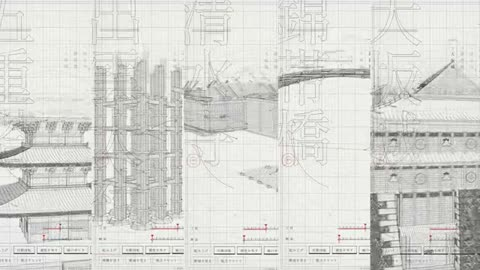

[← Back to gallery](../browse/education.en.md) · [简体中文](2105746986339283305.md)

# Five Japanese Buildings Assembled in Lines

**[FUJI / Presentation designer · @yoshifujidesign](https://x.com/yoshifujidesign)** · Education & explainers · 16s

> Discovery pool · Source verified; catalog details being completed.

**[▶ Open gallery to play](https://guanmo-ai.github.io/awesome-ai-motion/?lang=en#case-2105746986339283305)** · [Original post](https://x.com/yoshifujidesign/status/2105746986339283305)

Click the cover to open the gallery and play.

[Building demo and page implementation](https://re-presentation.jp/tool/KigumiArchitecture.html)

Wireframe structures assemble in an architectural animation made with Three.js and Canvas.

## Source & web pages

- **Public web page**：[Building demo and page implementation](https://re-presentation.jp/tool/KigumiArchitecture.html)
  The page contains implementation code; no open-source license was found.
  [Link source](https://x.com/yoshifujidesign/status/2105746986339283305) · Link checked 2026-10-16 06:52 UTC

No public prompt has been verified. [View the original post](https://x.com/yoshifujidesign/status/2105746986339283305)

Bookmarks 547 · Likes 727 · Views 47,915

## Source record

- Original post: [@yoshifujidesign](https://x.com/yoshifujidesign/status/2105746986339283305) · 2026-10-01T19:49:39+00:00
- Model attribution: Opus 5.5 · [Creator’s statement](https://x.com/yoshifujidesign/status/2105746986339283305)
- Prompt lookup: [Creator post](https://x.com/yoshifujidesign/status/2105746986339283305) · 2026-10-16 06:52 UTC
- Cover source: [Original cover source](https://x.com/yoshifujidesign/status/2105746986339283305) · 3.1s
- Metrics snapshot: [Original X post](https://x.com/yoshifujidesign/status/2105746986339283305) · 2026-10-16 06:52 UTC
- Gallery video source: [Original post media record](https://x.com/yoshifujidesign/status/2105746986339283305) · 2026-10-16 06:52 UTC · Post/media correspondence and media response checked; external reference, no re-upload

Model attribution is based on creator statements. Prompts have not been independently rerun; sound and visuals have not received a uniform quality rating. Videos reference original post media, not our uploads; redistribution permission has not been verified.
