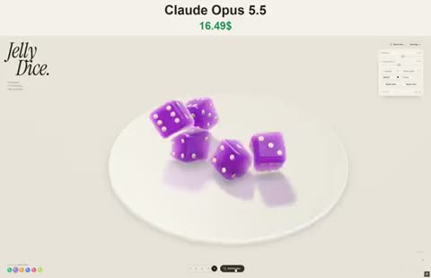

[← 返回图库](../browse/interactive.md) · [English](2105832839023415521.en.md)

# 果冻骰子的跌落与回弹

**[Vib3Coded · @vib3coded](https://x.com/vib3coded)** · 交互演示 · 16s

> 发现池 · 来源已核对，编目资料待完善。

**[▶ 打开画廊播放](https://guanmo-ai.github.io/awesome-ai-motion/#case-2105832839023415521)** · [作者原帖](https://x.com/vib3coded/status/2105832839023415521)

点击封面打开画廊播放。

半透明骰子落在圆盘上，挤压后逐渐恢复形状；作者说明每颗骰子使用节点网格处理伸缩和形态恢复。

未取得作者公开提示词。 [查看作者原帖](https://x.com/vib3coded/status/2105832839023415521)

收藏 33 · 点赞 73 · 浏览 6,617

## 来源记录

- 作品原帖: [@vib3coded](https://x.com/vib3coded/status/2105832839023415521) · 2026-10-02T01:30:47+00:00
- 模型归因: Claude Opus 5.5 · [作者说明](https://x.com/vib3coded/status/2105832839023415521)
- 提示词查阅记录: [作者原帖](https://x.com/vib3coded/status/2105832839023415521) · 2026-10-22 08:51 UTC
- 封面来源: [原帖封面来源](https://x.com/vib3coded/status/2105832839023415521) · 3.2s
- 互动快照: [X 原帖](https://x.com/vib3coded/status/2105832839023415521) · 2026-10-22 08:51 UTC
- 画廊原视频: [原帖媒体记录](https://x.com/vib3coded/status/2105832839023415521) · 2026-10-22 08:51 UTC · 已核对原帖媒体对应与媒体响应；外部引用，不重新上传

模型依据来自作者自述，未独立重跑提示词，也未对音画作统一质量评级。视频引用作者原帖媒体，未由本站重新上传，转载许可未确认。
